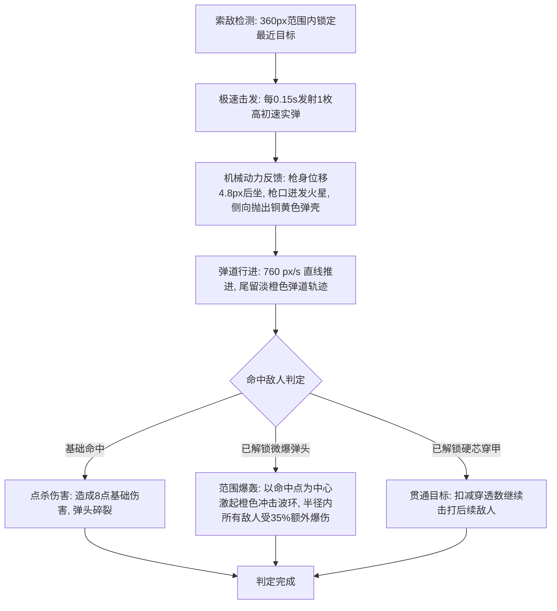

# AK47 战术步枪（AK47 Tactical Rifle）武器攻击设计说明

> 武器系列文档：[青玉剑](file:///Users/edy/myProject/aabbBox/设计说明/弹壳打工/青玉.md) · [回旋飞刃](file:///Users/edy/myProject/aabbBox/设计说明/弹壳打工/回旋飞刃.md) · [脉冲炮](file:///Users/edy/myProject/aabbBox/设计说明/弹壳打工/脉冲炮.md) · [弧光太刀](file:///Users/edy/myProject/aabbBox/设计说明/弹壳打工/弧光太刀.md) · [AK47](file:///Users/edy/myProject/aabbBox/设计说明/弹壳打工/AK47.md)

---

## 一、武器基本信息与卡片设计

| 属性维度 | 参数数值 / 设定 | 说明 |
| :--- | :--- | :--- |
| **武器标识 / 名称** | `ak47` / **AK47** | 经典战术突击步枪 |
| **战术定位** | **极速连射 · 破甲溅射** | 持续高频火力压制，升级后兼具群爆 |
| **适配出战角色** | **巡游者**（温室巡游者） | 巡游者可选经典高射速主武器 |
| **基础伤害** | **8 点** | 单发低伤，以超高频率堆积总体 DPS |
| **攻击频率 / 连射间隔** | **0.15 秒/发**（**6.67 发/秒**） | 全武器最高攻速，机枪级持续泼水 |
| **有效索敌射程** | **360 px** | 全武器初始最远射程 |
| **弹丸飞行速度** | **760 px/s** | 极速破空实弹轨迹 |
| **初始发射弹数** | **1 发** | 升级可形成双发/多发密集点放 |
| **初始穿透次数** | **0 次** | 默认单体硬点杀伤 |
| **初始爆破溅射** | **0 px** | 升级【微爆弹头】后激活范围冲击爆破 |
| **发射枪口偏移** | **39 px** | 步枪修长枪管前端击发 |
| **动作硬直 / 后坐力** | 硬直 **0.10 秒**，后坐力位移 **4.8 px** | 全武器最大后坐力，开火时枪身震颤与抛壳 |

### 准备页卡片视觉规范
- **布局设计**：卡片顶端展示序号 `4 / 5`，底端为半透明黑底标签居中展示武器名 `AK47`；左右切换箭头悬浮于卡片两侧。
- **武器图标**：
  - **枪机与机匣**：金属枪机（`#667687`），搭配经典木纹橙色护木与枪托（`#d96e32`）。
  - **弹匣与准星**：斜置 6° 倾斜角，黑色下弯战术弹匣（`#3d4650`）与枪口消焰器。

---

## 二、战斗机制与循环流程

### 1. 极速开火与后坐反馈
- **高频击发**：基础间隔仅 0.15s，开火时角色枪身产生 4.8px 明显向后震颤（`p.recoil = 4.8`）。
- **抛壳动力学细节**：每次击发时，向枪身侧后方（$a - \frac{\pi}{2}$）以 65px/s 初速弹射出微小铜黄色粒子（`#d6a34c`），在 0.4s 内翻滚减速消散，极富机械手感。

### 2. 微爆弹头溅射算法（Splash Explosive）
- 当玩家学习【微爆弹头】后，子弹命中怪物将激起最大半径为 `splash` 的爆轰光环（`ripples` 橙色冲击波）。
- 并在命中点半径范围内的其他敌人身上触发范围伤害判定：
  $$\text{dist}(other, b) < \text{splash} \implies \text{伤害} = b_{\text{damage}} \times 0.35$$
  从本质上将单体机枪升维为“微型火箭炮”群伤武器。

---

## 三、视觉与音效设计（VFX & Audio）

### 1. 特效表现（VFX）
- **战术攻击范围圈**：
  - 边界发光：暖橙战术射击主题（`#ffaa40`，投影 `rgba(255, 170, 64, 0.36)`）。
  - 内环填充：微弱暖橙辐射光晕（`rgba(255, 170, 64, 0.032)`）。
- **实弹与枪焰渲染**：
  - **枪口火光**：开火瞬间枪口喷射多角火焰刺芒（`#fff7d0` / `#ff9f3d`）与 5 枚火星粒子。
  - **飞行弹体**：圆角矩形铜色弹体（`#fff0bc`）与橙红锐利弹头（`#ff8a35`），尾部拖曳 4 节高速淡橙轨迹。
- **微爆冲击波**：命中触发橙黄扩散爆轰光环（`rgba(255, 167, 76, alpha)`，线宽 4px）。

### 2. 音效设计（Audio）
- **射击连发音**：145Hz 低沉爆裂方波（持续 0.045s）搭配 860Hz 机械撞针敲击脆音（0.025s）。
- **命中击中音**：190Hz 方波击打闷响，并内设 55ms 防重叠门阀避免极高攻速下的声音破音撕裂。

---

## 四、升级进化与突破路线

### 1. 武器专属强化分支

| 强化阶层 | 技能名称 | 强化效果说明 | 解锁条件 / 上限 |
| :--- | :--- | :--- | :--- |
| **专属基础** | **双发点放** | 每次额外发射 **1 枚** 步枪弹（1 → 2 → 3） | 子弹数量上限 < 4 发 |
| **专属基础** | **硬芯穿甲** | 子弹额外穿透 **1 个** 目标（0 → 1 → 2 → 3 → 4） | 穿透上限 < 5 次 |
| **专属基础** | **微爆弹头** | 命中产生范围爆破，半径 **+10 px**（爆轰伤害为 35% 范围溅射） | 爆破半径上限 < 50 px |
| **超武突破** | **战术超载** | 步枪伤害 **+15%**，攻击速度 **+6%**（发射间隔缩短至 94%） | 专属升级选满后开启 |

### 2. 通用协同增益建议
- **微爆弹头 + 硬芯穿甲组合**：子弹每次穿透均可在不同怪物身上诱发一次微爆，产生连锁群怪轰爆。
- **聚能校准（伤害 +30%）**：直接提高基础伤害，同时按比例放大微爆溅射的杀伤力。
- **致命镜面（暴击 +10%）**：由于每秒开火 6.67 发以上，高暴击率能产生极其密集的黄色暴击数字瀑布。
