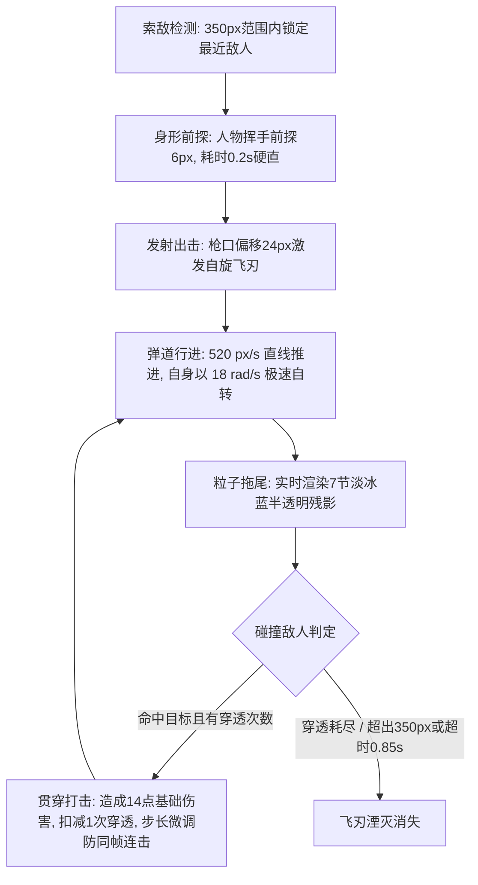

# 回旋飞刃（Boomerang Dart）武器攻击设计说明

> 武器系列文档：[青玉剑](file:///Users/edy/myProject/aabbBox/设计说明/弹壳打工/青玉.md) · [回旋飞刃](file:///Users/edy/myProject/aabbBox/设计说明/弹壳打工/回旋飞刃.md) · [脉冲炮](file:///Users/edy/myProject/aabbBox/设计说明/弹壳打工/脉冲炮.md) · [弧光太刀](file:///Users/edy/myProject/aabbBox/设计说明/弹壳打工/弧光太刀.md) · [AK47](file:///Users/edy/myProject/aabbBox/设计说明/弹壳打工/AK47.md)

---

## 一、武器基本信息与卡片设计

| 属性维度 | 参数数值 / 设定 | 说明 |
| :--- | :--- | :--- |
| **武器标识 / 名称** | `dart` / **回旋飞刃** | 科技轻型战术投掷武器 |
| **战术定位** | **远程贯穿 · 密集弹幕** | 擅长中远距离路径穿透与群体压制 |
| **适配出战角色** | **巡游者**（温室巡游者） | 巡游者军械库可选主武器 |
| **基础伤害** | **14 点** | 配合多段穿透可成倍放大杀伤总量 |
| **攻击频率 / 发射间隔** | **0.46 秒/次**（约 2.17 次/秒） | 稳定连击节奏 |
| **有效索敌射程** | **350 px** | 战场远距覆盖索敌圈 |
| **飞刃飞行速度** | **520 px/s** | 匀速直线贯穿推进 |
| **初始投掷数量** | **1 把** | 升级可形成扇面双生/多刃并掷 |
| **初始穿透次数** | **1 次** | 穿透第 1 个敌人后继续飞掠击打第 2 个目标 |
| **飞刃判定尺寸** | **1.0x**（有效碰撞半径 5 px） | 基础尺寸，可通过【锋刃扩径】放大 |
| **发射枪口偏移** | **24 px** | 枪口持握点前方射出，微分散角 0.14 rad |
| **动作硬直 / 位移** | 硬直 **0.20 秒**，投掷前探 **6 px** | 人物向目标方向短暂停顿并前倾出击 |

### 准备页卡片视觉规范
- **布局设计**：卡片顶端展示序号 `1 / 5`，底端为半透明黑底标签居中展示武器名 `回旋飞刃`；左右切换箭头悬浮于卡片两侧。
- **武器图标**：
  - **飞刃外轮廓**：科技银灰菱形折角双刃（`#aeb9ca`），外圈附有深黑色利落描边（`#101a18`）。
  - **能量核心**：中心内嵌亮红橙聚能圆环（`#ff7057`），形成高对比能量发射节点。

---

## 二、战斗机制与循环流程

### 1. 索敌与出击阶段（Launch Phase）
- **索敌策略**：当索敌范围内存在敌人时，计算目标与角色中心连线方位角 $\theta = \text{atan2}(dy, dx)$。
- **发散角度分配**：
  - 单刃发射时：严格沿索敌角正向射出。
  - 多刃发射时：以基础发散度 $0.14 \text{ rad}$ 沿中轴对称微偏（`shotOffset(i)`），形成交错飞掠弹幕。
- **动作联动**：角色持刃手臂瞬时逆时针回缩至顺时针甩出（角度自 `-0.5` 转至 `+0.35` rad），附带 6px 前探位移。

### 2. 弹道飞行与物理自旋（Ballistics Phase）
- **高速自转**：飞刃在沿速度向量前进的同时，自身以角速度 $\omega = 18 \text{ rad/s}$ 不断自转。
- **残影流线**：记录历史 7 个帧位坐标，动态绘制阶梯透明度（Alpha 从 0.16 渐变至 1.0）的淡冰蓝飞刃残影。
- **消亡阈值**：弹刃最大寿命计算公式为 $T_{\text{max}} = \frac{\text{range}}{\text{speed}} + 0.18\text{s} \approx 0.85\text{s}$，越过战场边界 $\pm 20\text{px}$ 时立即回收。

### 3. 多段贯通机制（Pierce Phase）
- **贯穿判定**：命中首个目标后造成全额伤害与击退火花，穿透次数计数器 `pierce--`。
- **防同体连击（Anti-Sticking）**：记录当前命中的敌人对象 `last = e`，并令飞刃坐标微调前进 $0.014 \times v$，确保飞刃平滑穿出该怪物体积后方可对下一个敌人进行判定。

---

## 三、视觉与音效设计（VFX & Audio）

### 1. 特效表现（VFX）
- **战术攻击范围圈**：
  - 边界发光：淡冰蓝微光（`rgba(214, 236, 255, 0.36)`，模糊 3~8px）。
  - 内环辐射：低饱和冷灰蓝渐变（`rgba(214, 236, 255, 0.032)`）。
  - 十字刻线：亮白战术准星与正前方动态跟踪弧光。
- **打击火花**：
  - 普通命中：迸发 4 枚亮白轻质火花（`#e8edf5`，初速 90px/s）。
  - 暴击命中：迸发 9 枚高亮金黄火花粒子（`#ffd86b`）与跳动暴击数字。

### 2. 音效设计（Audio）
- **投掷出击音**：820Hz 三角波快速滑音至 360Hz（持续 0.065s），利落清脆的划空风鸣。
- **命中贯通音**：980Hz 方波击穿音快速下落至 610Hz（持续 0.035s），带有清晰的撕裂破甲感。

---

## 四、升级进化与突破路线

### 1. 武器专属强化分支

| 强化阶层 | 技能名称 | 强化效果说明 | 解锁条件 / 上限 |
| :--- | :--- | :--- | :--- |
| **专属基础** | **双生飞刃** | 每次额外投掷 **1 把** 飞刃（1 → 2 → 3 → 4） | 投掷数量上限 < 5 把 |
| **专属基础** | **相位穿刺** | 飞刃额外穿透 **2 个** 目标（1 → 3 → 5 → 7） | 穿透上限 < 8 次 |
| **专属基础** | **锋刃扩径** | 飞刃尺寸 **+22%**，伤害 **+12%** | 尺寸倍率上限 < 2.0x |
| **超武突破** | **回旋增幅** | 飞刃伤害 **+15%**，攻击速度 **+6%**（发射间隔缩短至 94%） | 专属升级选满后开启 |

### 2. 通用协同增益建议
- **神经超频（攻速 +16%）**：将投掷间隔缩短至 0.38s 以下，形成连绵不绝的旋转利刃墙。
- **聚能校准（伤害 +30%）**：大幅强化单次贯穿基础伤害，配合 7 次穿透可瞬间蒸发整行怪物。
- **远距索敌（范围 +20%）**：射程由 350px 扩展至 420px，在怪物靠近前完成远程击溃。
