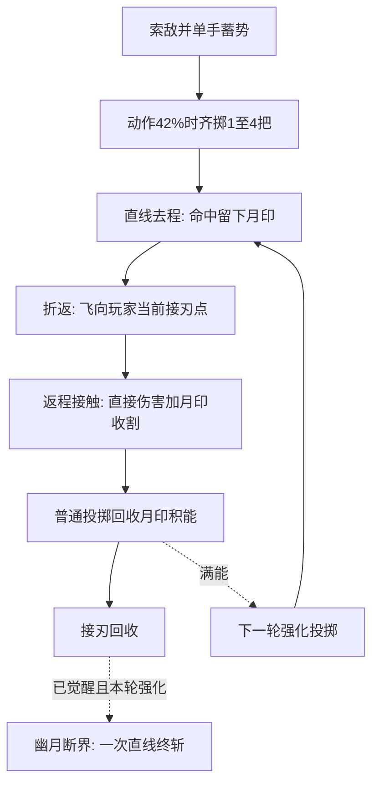

# 幽月回刃 · 武器与升级玩法设计说明

> 武器系列文档：[青玉剑](青玉.md) · [幽月回刃](幽月回刃.md) · [零域脉冲炮](零域脉冲炮.md) · [弧光太刀](弧光太刀.md) · [AK47](AK47.md)

---

> **文档状态（2026-10-14）：以下记录当前已接入的代码行为。** 幽刃齐发、幽月刻印、血玉蓄锋和超武幽月断界已实现；旧专属池已替换。玩法为“去程刻印、返程收割、血玉蓄能、接刃终斩”，不依赖刀锋上的齿纹。数值尚待进一步实机平衡。

## 一、武器基本信息与卡片设计（当前已实现）

基础属性以未选强化的新开局为准。时间为游戏模拟秒，暂停和升级选卡时不推进；射程、弹体速度与碰撞范围为世界像素，人物绘制缩放0.6不再乘到这些数值上。伤害内部保留小数，界面与飘字按Math.round显示。

| 属性维度 | 参数数值 / 设定 | 说明 |
| :--- | :--- | :--- |
| **武器标识 / 名称** | `dart` / **幽月回刃** | 黑色刀面、绯红刀锋的卡通双弯刃 |
| **战术定位** | **远程贯穿 · 密集弹幕** | 擅长中远距离路径穿透与群体压制 |
| **适配出战角色** | 推荐 **巡游者** | 当前也可选择小韩后，再手动切换本武器 |
| **基础伤害** | **14 点** | 配合多段穿透可成倍放大杀伤总量 |
| **攻击频率 / 发射间隔** | **0.46 秒/次**（约 2.17 次/秒） | 稳定连击节奏 |
| **有效索敌射程** | **350 px** | 战场远距覆盖索敌圈 |
| **飞刃飞行速度** | **520 px/s** | 匀速直线贯穿推进 |
| **初始投掷数量** | **1 把** | 幽刃齐发每级+1，最多4把扇形齐掷 |
| **初始穿透次数** | **1 次** | 每把去程最多命中2个不同目标；解锁折返后返程另有2个目标预算 |
| **飞刃判定尺寸** | **1.0x**（有效碰撞半径 5 px） | 普通飞刃尺寸；血玉强化为1.35倍，觉醒强化为1.75倍 |
| **发射位置** | 当前动画的圆环握持点 | 配置 `muzzle=24` 为原始参考偏移；幽月回刃实际按握持点转世界坐标，多刃按0.14 rad间隔围绕索敌方向对称分散 |
| **投掷动作时长** | `min(0.20s, 发射间隔×0.82)` | 默认 **0.20 秒**；没有移动硬直，蓄势与收势只改变绘制姿态 |

### 战场攻击范围显示
- 参照青玉剑，始终在角色脚下绘制 **宝石红（`#e85b70`）** 范围圈，默认半径 **350 个世界像素**；逐帧读取`min(G.stats.range, 520×1.2)`，范围强化后同步扩大，当前有效上限624px，不受角色 `MODEL_SCALE=.6` 缩放影响。
- 使用淡色填充、发光边界、流转虚线、四向刻度与朝向弧光，绘制在角色、敌人和弹体下方；敌人进入圈内或攻击时增强亮度。
- 实际半径超过视口可容纳的半径时，保留真实范围圈，额外显示角色中心的内收虚线提示圈（半径 `max(24, min(width,height)/2 - 20)`），并标注“射程 数值 · 超出视野”。此提示圈不代表伤害边界；数值按当前范围四舍五入显示。范围完整可见时不显示文字。
- 范围圈说明基础索敌距离；实际弹道、太刀扇面、飞剑追击与命中体积判定仍按各武器战斗规则执行。显示由 Canvas 实时绘制，无新增图片素材。详见 [总体玩法](总体玩法.md#攻击范围显示)。

### 准备页卡片视觉规范
- **布局设计**：卡片顶端展示序号 `1 / 5`，底端为半透明黑底标签居中展示武器名 `幽月回刃`；左右切换箭头悬浮于卡片两侧。
- **武器图标**：
  - **造型与主色**：参考项目青玉剑的粗描边和简化色块，保持两片对向弯刃围绕中空圆环的S形轮廓。宽刀面为黑色与石墨灰，外侧窄刀锋为连续、平滑的绯红金属刃带，已去掉灰色齿纹与齿轮装饰。圆环和刃根仍为黑色、石墨灰金属。八颗红宝石保留：圆环四颗，两侧刃根和刀面中段各一颗；握持孔保持透明。
  - **当前素材**：`frontend/素材库/弹壳打工/weapons/dart-black-red-edge-selected.png`，1254×1254 RGBA 透明 PNG；画布中心为旋转轴，圆环孔与背景均为真实透明。准备页、升级卡大图及小图、底部装备栏、战场手持、飞行弹体均复用此素材。
  - **准备页衬底**：石墨灰径向渐变（`#637179 → #252d34`），衬出黑色刀面、连续绯红刀锋和红宝石。
  - **来源**：内置 imagegen 原创生成并局部编辑，风格参考为本项目 `weapons/sword.png`。当前按用户选定的无齿纹版本直接复制原图，保留绯红刀锋和八颗宝石，未重新生成或校色。未使用外部青玉剑原图作为正式素材。
  - **制作记录**：`离线素材库/弹壳打工/制作记录/幽月回刃/` 保存提示词、初稿与预览；旧 `weapons/dart.svg`、`weapons/dart-black.png`、`weapons/dart-black-ruby.png`、误将刀面改红的 `weapons/dart-dark-red.png` 与有齿纹版 `weapons/dart-black-red-edge.png` 仅作历史记录。

### 战场显示口径
- 飞行弹体绘制画布为 **24×24 世界像素 × 尺寸倍率**，绕画布中心自转；透明边距计入画布，碰撞半径仍为 **5 px × 尺寸倍率**。
- 手持飞刃绘制画布为 **34×34 模型像素**，圆环中心跟随持刃手；待机时握持点在朝向侧腰部 `(±24, 10)`，上下索敌时也不会把待机武器举到脸前。人物整体按 `MODEL_SCALE=0.6` 缩放。受击时添加轻微银白高光。
- 两个角色均采用独立肩、肘、腕与握持点绘制；投掷手扣住圆环，另一只手用于平衡。巡游者不绘制静态手臂，小韩在绘制时裁去原 PNG 的静态手臂区域，再绘制青袍袖口与动态双手；原角色素材保持原样，准备页头像沿用完整 PNG。
- 向上投掷时将持刃手臂与武器放到身体后方，避免盖住脸；其余方向根据手腕位置决定前后层级。动作叠加少量侧身、压肩与短银灰甩腕弧线，弧线仅为视觉表现，不参与伤害。
- 图片加载失败或未完成时，Canvas 后备同步绘制黑色刀面、连续绯红刀锋、金属圆环与八处红宝石，已移除三角齿纹绘制；战斗不依赖图片加载完成。宝石与配色目前仅为视觉设计，不附加伤害或技能。
- 新开局基础伤害14、射程350、航速520、发射间隔0.46s。飞行自转保持每秒0.5圈；解锁幽刃齐发后实体折返追向当前持握点。返程不阻塞下一轮投掷，普通手持补刃动作沿用现有节奏。

---

## 二、战斗机制与动作时序（当前已实现）

- **索敌与快照**：在有效范围内锁定最近敌人并收臂蓄势，保存本轮方向、数量、伤害、射程、航速、各级能力、是否强化与是否觉醒。选卡不追溯修改已蓄势或在途飞刃。
- **动作时序**：默认动作200ms，在28%完成收臂、42%（84ms）甩腕出刃、68%空手收势、78%开始补刃、100%恢复腰侧持刃。高攻速按`min(0.20s, rate×0.82)`压缩，每轮仅发射一次、播放一次出手音效。
- **随手出刃**：发射坐标为`player位置 + 当前hand模型坐标×0.6 + 人物上下起伏`。蓄势过程中移动时跟随实际手部出刃；目标消失仍沿锁定方向完成投掷。
- **去程与返程**：每把去程直线前进，解锁幽刃齐发后在有效距离、命中预算或围墙处折返，朝玩家当前握持点回收。两段各维护命中集合和2个目标预算，使用运动线段碰撞，避免高速漏判。同一敌人可以分别受到同把的去程和返程各一次伤害。
- **旋转与拖影**：主体按π rad/s自转，即每个游戏模拟秒0.5圈；保持7帧历史残影、主体82%的残影尺寸和最高0.16透明度。去程连接线为淡红，返程连接线为暗红，强化飞刃有轻微宝石红光晕。
- **未升级弹体**：仍只有1把直线飞刃，最多命中2个不同目标，最大寿命`有效range/520 + 0.18s`，默认约0.853s；耗尽命中预算、超时或异常越界时消失，不产生接刃奖励。
- **结算与回收**：月印、血玉、折返和终斩的完整规则见第五节。暂停及升级选卡冻结模拟；结束、重开和换关清理在途对象与月印。

---

## 三、视觉与音效设计（当前已实现）

### 1. 特效表现（VFX）
- **战术攻击范围圈**：
  - 边界发光：宝石红（`rgba(232,91,112,.42)`），光晕`#e85b70`，模糊3～8px。
  - 内环辐射：低透明红色渐变（`rgba(232,91,112,.032)`）。
  - 四向刻度与朝向弧光：浅宝石红`#ff9eac`；超出视口的提示规则见第一节。
- **打击火花**：
  - 投掷出击：4 枚灰青火花（`#b0d4ca`，速度随机 22.5–90px/s）。
  - 普通命中：5 枚灰青火花（`#b0d4ca`，速度随机25～100px/s），为当前代码的特效配色。
  - 暴击命中：迸发 9 枚高亮金黄火花粒子（`#ffd86b`）与跳动暴击数字。

### 2. 音效设计（Audio）
- **投掷出击音**：820Hz 三角波快速滑音至 360Hz（持续 0.065s），利落清脆的划空风鸣。
- **命中贯通音**：980Hz 方波击穿音快速下落至 610Hz（持续 0.035s），带有清晰的撕裂破甲感。

---

## 四、当前升级池与选卡规则（已实现）

| 强化 | 上限 | 当前效果 |
| --- | --- | --- |
| 幽刃齐发 | 3级 | 每级抛掷+1，1→2→3→4把；首级解锁实体折返，返程倍率65%→80%→95% |
| 幽月刻印 | 3级 | 幽刃齐发≥1后可选；去程留印，返程单目标最多收割1→2→3层 |
| 血玉蓄锋 | 3级 | 幽月刻印≥1后可选；蓄能门槛8→6→4，满槽强化下一轮全部飞刃 |
| 幽月断界 | 每局一次 | 齐发3＋刻印2＋蓄锋2满足后的下一次升级必定赠送，强化飞刃接回发动直线终斩 |

每次提供两张通用＋一张合法专属，通用排前。三个分支全满后改为三张通用；觉醒卡为额外第四张赠送卡，完成本次常规选卡时一并生效。旧“双生飞刃／相位穿刺／锋刃扩径／回旋增幅”不再进入本武器候选池。

通用强化继续生效：神经超频缩短投掷间隔，聚能校准增加基础伤害，普通池不再提供远距索敌，巡游步伐改善回刃拉线。详见第五节。

---

## 五、专属升级与超武完整规则（当前已实现）

### 1. 设计定位与青玉剑的区别

**核心：去程刻印 → 走位拉回刃 → 返程收割 → 红宝石蓄能 → 强化投掷 → 接刃终斩。** 玩家把敌人留在去返两段弹道之间，用横向走位改变回收路径。标记以敌人身边的小月印表现；武器刀锋保持平滑，不使用齿轮或齿状纹路。

| 对比项 | 青玉剑：现有玩法参考 | 幽月回刃：当前玩法 |
| --- | --- | --- |
| 核心成长 | 4→16柄飞剑，顺次出击 | 每轮1→4把扇形齐掷，通过折返、刻印和蓄能提高单轮收益 |
| 飞行方式 | 飞剑追踪敌人，命中后重新寻敌 | 去程锁定方向，返程只追玩家接刃点，不追怪 |
| 走位价值 | 保命，飞剑自主覆盖目标 | 横移拉线，使回刃穿过带印目标 |
| 回收节奏 | 归鞘后独立冷却1s | 接刃不增加独立冷却；按原发射间隔开始下一轮 |
| 超武形态 | 敌人脚下驻留2s的三圈剑阵 | 强化飞刃接回时发动一次直线终斩 |
| 觉醒方式 | 万剑诀选3次后，每次选卡60%概率 | 固定分支配方满足后，下一次升级必定赠送 |

本节数值已接入代码，尚待进一步实机平衡。沿用新开局14伤害、0.46s发射间隔、520px/s去程航速、初始每轮1把、每把每阶段2个目标的基线；实体折返须先选择幽刃齐发才生效。

### 2. 三条专属强化分支

每条最多3级，共9次专属强化。每次选卡升一级，直接使用该级的目标值，避免加乘后越过上限。

| 新分支 | Lv.1 | Lv.2 | Lv.3 | 前置与卡片简述 |
| --- | --- | --- | --- | --- |
| **幽刃齐发** | 抛掷数量+1（1→2把）；解锁实体折返，返程直接伤害65% | 抛掷数量+1（2→3把）；返程直接伤害80% | 抛掷数量+1（3→4把）；返程直接伤害95% | 无前置；每级显示“抛掷数量+1”及数量变化，同时展示解锁折返或返程倍率变化 |
| **幽月刻印** | 去程命中叠1层月印；返程每目标最多消耗1层 | 每目标最多消耗2层 | 每目标最多消耗3层 | 幽刃齐发≥1；首级“去程留印，回程收割”，后续显示收割上限1→2／2→3层 |
| **血玉蓄锋** | 回收月印积能；满8点强化下一掷 | 蓄能门槛6点 | 蓄能门槛4点 | 幽月刻印≥1；首级“回收8印，强化下一掷”，后续显示门槛8→6／6→4 |

- **幽刃齐发每级增加1把抛掷飞刃**，数量按`N=1+幽刃齐发等级`计算：未升级1把，Lv.1为2把，Lv.2为3把，Lv.3为4把；保留各级65%／80%／95%的返程直接伤害倍率。每把独立维护去程、返程各2个不同目标的命中预算；返程预算用尽仍继续飞回，但不再造成返程接触伤害。
- 月印每层提供本轮有效伤害的35%收割附伤；最多叠3层，持续3s。等级改变一次能消耗的层数，单层倍率固定。月印没有持续掉血、减速或易伤。
- 血玉强化投掷始终为基础伤害1.60倍、飞刃显示尺寸和碰撞半径1.35倍；分支等级只降低蓄能门槛，不重复叠乘强化倍率。
- 每轮在动作42%时同时抛出N把，沿锁定索敌方向按0.14 rad间隔对称扇形分散，复用一次投掷动作与出手音效。各把独立折返和接回，允许多轮同时在途，不等上一轮全部接回才开始下一轮；不添加环绕护体飞刃。
- 当前专属池替换旧“双生飞刃／相位穿刺／锋刃扩径／回旋增幅”池，初始数量、穿透余量和尺寸保持1，数量仅由幽刃齐发提升至最多4把；新旧池不并行叠加。从新开局应用，刷新页面后重新开局即可使用。

### 3. 去程、返程与月印结算

以下为当前代码的实际规则。

**去程。** 沿出手时的索敌方向直线飞行，不转向追怪。有效射程为`min(本轮range, 本轮航速×1.2s)`，索敌与去程距离共用该值，默认仍为350px，面板显示有效值。达到有效距离、命中预算耗尽或碰到世界内围墙时转返，折返点T只记录一次。未解锁幽刃齐发时仍使用当前直线弹体的寿命与消失规则。

**返程。** 每帧朝玩家当前圆环持握点调整方向，速度为`max(650px/s, 去程航速×1.25, 玩家当前移速×1.8)`，最多持续3s；不重新索敌。每把飞刃的去返各维护独立命中集合，同一敌人对同一把飞刃每阶段最多受击一次，允许去程、返程各命中同一个目标。

**接刃。** 进入持握点12px内，或本帧运动线段穿过接刃范围，即成功回收。两段飞行均使用运动线段碰撞，避免高速越过怪物或接刃点。返程超时、异常越界、玩家死亡或本局结束时只回收对象，不产生接刃奖励或终斩。

**月印。** 幽月刻印解锁后，去程命中时先叠1层，再结算伤害；存活目标最多3层，每次叠印刷新整组3s有效期。标记属于当前玩家的幽月回刃，不绑定某一把飞刃，允许同轮多把或多轮叠印后由另一把回刃收割；多把同帧命中时按稳定的飞刃序号逐把结算，已消费的月印立即移除。返程先取出并移除可消耗层，再合并直接伤害与附伤结算；剩余层保留原到期时间。标记超时、敌人死亡、重开或换关时清除。

**单把收割预算。** 每把飞刃对同一敌人的返程与终斩合计最多消费3层，以稳定敌人对象为键记录该把已消费层数c。即使其他在途飞刃在返程与终斩之间补上新印，本把仍最多再消费3−c层；未消费的新印保留给后续投掷。

**去程击杀补偿。** 本次去程叠印后直接击杀目标，最多回收本次新加的1层，不附加收割伤害；普通投掷仍可获得1点血玉能量，避免弱怪被秒杀后无法蓄能。此前旧层随死亡清除，不额外兑换能量。

### 4. 血玉蓄能与强化投掷

1. 血玉蓄锋解锁后，普通投掷每实际消耗1层月印增加1点能量；去程击杀补偿也计入。无印命中、空投、暴击倍数、接刃本身和时间停止不产生能量。
2. 能量按当前等级门槛封顶，不随时间衰减；满槽溢出不保留，不连续赠送多次强化。角色身周由Canvas绘制八个小菱形宝石指示，按能量比例逐个点亮，满能或正在强化蓄势时全亮；武器原PNG中的八颗宝石保持原图。指示颗数不等于各等级的能量上限。装备栏同步显示血玉点数与下一掷强化状态。
3. 下一次有目标并开始蓄势时扣除满槽能量、锁定`charged=true`，本轮数量、伤害与尺寸写入快照；同轮N把均为强化飞刃，一轮只扣一次满槽能量，暂停或升级不再次扣能。没有目标则保持满槽等待。
4. 强化投掷仍叠印、收割，但同轮全部N把的命中、击杀与终斩均不产生能量，防止强化攻击自我充能；其他同时在途的普通飞刃仍能贡献能量。
5. 提升血玉等级时将已有能量按新门槛封顶，达到门槛则下一轮可强化。已经蓄势或在途的飞刃不因此改换普通／强化状态。
6. 默认动作仍为200ms、84ms出手，高攻速按`min(0.20s, rate×0.82)`压缩。返程不抢占正在进行的投掷；接刃统一用小型红色收光圆环反馈，手持下一把沿用已有淡入补刃表现，不额外抢占手臂动作。

### 5. 超武突破：幽月断界

**固定觉醒配方：幽刃齐发Lv.3＋幽月刻印Lv.2＋血玉蓄锋Lv.2。** 至少需7次对应专属强化。配方满足后的下一次升级选卡，必定额外展示第4张金色“幽月断界”，完成常规选卡时一并自动获得，不占普通三选一名额；每局仅觉醒一次，无60%随机判定。赠送卡不直接增加常驻基础伤害。

- 普通投掷继续原循环。只有觉醒后发出的强化飞刃成功接回时触发终斩；返程接触预算用尽仍可接回触发，超时消失不触发。
- 觉醒强化投掷沿用幽刃齐发的数量，配方要求Lv.3，因此每轮为4把；每把成功接回时各触发一次自身终斩，异常消失的该把不触发。伤害倍率保持1.60，显示尺寸和碰撞半径从1.35改为1.75倍；黑色刀面和连续绯红刀锋保持原样，用放大与红宝石亮光表现强化，不增加齿纹。
- 将该把折返点T和实际接刃点P连成终斩线，长度超过600px时只保留靠近玩家的最后600px；线宽24px，不随通用射程无限扩长。
- 每把的终斩对每个目标只结算一次，不同飞刃的终斩可以分别命中同一目标：本轮有效伤害的100%，再在该把3层总收割预算内消耗剩余月印，每层附加35%。未消费的新印保留；同一层不能被返程和终斩重复消费，终斩不叠新印、不产生能量、不派生第二次终斩。
- 碰撞为敌人中心到线段的最短距离≤12px＋敌人碰撞半径，能覆盖本把去程／返程未命中的目标。
- 暗红裂光沿线闪过，残线在0.18s内淡出；伤害仅在生成时结算一次，不持续扫圈，不在敌人脚下产生驻留阵法。

### 6. 伤害公式、暴击与成长示例

以下公式为当前代码口径。D为蓄势开始时的基础伤害快照（含通用伤害加成）；普通投掷B=D，强化投掷B=1.60D；返程倍率R取0.65／0.80／0.95。

| 结算事件 | 非暴击公式 | 层数约束 |
| --- | --- | --- |
| 去程接触 | B | 叠1层，同一目标每去程一次 |
| 返程接触＋收割 | B×(R＋0.35m) | m=min(现有层数, 刻印等级, 3−c)，未解锁刻印时为0 |
| 幽月断界终斩 | B×(1＋0.35n) | n=min(现有层数, 3−c)，c为本把对该目标已消费层数 |

- 每次接触将直接伤害与附伤合并，只判一次暴击；终斩另判一次。初始暴击为2倍，会心一击每张使暴击倍率增加0.25，能量按实际层数计数，不随暴击倍率增加。
- 内部保留小数，界面按Math.round显示；残影和淡出光线不参与伤害，同一弹体／终斩事件去重。
- 本轮快照包含抛掷数量、伤害、射程、航速、两段预算、返程倍率、刻印能力与消耗上限、蓄能能力、是否强化和是否觉醒；选卡只影响新投掷。能量槽的封顶门槛按当前血玉等级处理。

示例取D=14、无暴击，一个从零月印开始且存活的目标，只观察单把飞刃的完整路径，假设同轮其他飞刃未命中该目标，排除其他在途飞刃和预存月印：

| 节点 | 完整命中路径 | 单把理论总伤害 |
| --- | --- | --- |
| 当前未升级 | 去程一次 | 14 |
| 齐发Lv.1，单把 | 去程14＋返程9.1 | 23.1 |
| 齐发Lv.3＋刻印≥1，普通投掷 | 去程14＋返程13.3＋收割1印4.9 | 32.2 |
| 同上，血玉强化投掷 | 去程22.4＋返程21.28＋收割7.84 | 51.52 |
| 幽月断界强化投掷，目标也在线内 | 上述51.52＋终斩22.4 | 73.92 |

理论合计用于设计对比，不要求把各阶段飘字合成一个数字。满配时单目标最多3层印，返程和终斩合计最多消费这些层；每把对单目标全链路理论上限为4B（不计暴击），N把全部命中时一轮上限为4NB，满级N=4即16B。月印全轮共享、消费后立即移除，实际收益取决于叠印与返程顺序，不能直接将上表的单把示例乘以数量作为固定伤害。不会逐帧重复叠伤。

### 7. 选卡、走位建议与表现

- **新手路线**：齐发1→刻印1→血玉1，先体验折返、收割、强化，再补觉醒配方。开局专属候选仅有幽刃齐发，避免拿到无前置支撑的能力。
- **群怪路线**：优先幽刃齐发的抛掷数量，再提高刻印消耗上限与血玉触发频率；去程留下标记后横移，让回刃穿过密集带印目标。回程绕开标记目标会损失收割和蓄能收益。
- **首领路线**：先幽刃齐发的抛掷数量与返程倍率，再通用伤害和暴击，控制走位让两段命中同一首领。首领同样最多3层印，没有百分比生命伤害或专属硬控。
- **通用协同**：神经超频增加投掷轮数，不取消蓄势；巡游步伐改善拉线，返速随移速提高；普通池已移除远距索敌，初始索敌范围仍为350px，去程预算仍为1.2秒；聚能校准提高伤害，会心一击同时增加暴击率与暴击伤害。
- **卡片**：保留两张通用＋一张合法专属，通用排前；专属显示等级变化与本次数据。3级后退出候选，三个分支全满时专属位补一张通用，不重复赠送超武。
- **觉醒进度**：装备栏显示各分支配方进度，例如“齐发3/3 · 刻印2/2 · 蓄锋2/2”，各项显示至配方等级为止；满足后显示“下次升级必定觉醒”。常驻伤害栏仍显示D，另用“血玉2/6／下一掷强化”表达能量。
- **月印**：敌人侧边最多3个小暗红月牙，消耗时碎成红光；不使用齿轮、三角齿纹或覆盖血条的长文字。去程淡红连接线，返程暗红连接线，折返点配合短银灰火花，区分两阶段。
- **强化**：角色周围的小菱形宝石指示按能量逐渐点亮，强化飞刃放大并带短红芒；宽刀面仍为黑色，绯红刀锋连续平滑。终斩使用单条裂光，与青玉剑的绿色多圈剑阵区分。

### 8. 实现范围与验收

游戏标识保持`dart`，当前代码已同步新中文技能名、升级候选池、装备栏数量、两段命中预算、血玉状态与觉醒进度。

| 能力 | 状态 | 实现方式 |
| --- | --- | --- |
| 单手持刃、200ms动作、42%出手 | 已实现 | 复用关节动作，接刃收光不抢占下一轮投掷 |
| 幽刃齐发、实体折返 | 已实现 | 每级数量+1、最多4把齐掷；逐把命中集合与预算、线段碰撞、动态接刃点、3s返程超时 |
| 幽月刻印、血玉能量 | 已实现 | 标记层数与到期时间、即时消费、单把收割预算、武器能量槽、整轮强化快照 |
| 幽月断界、固定配方觉醒 | 已实现 | 每局一次赠送第四卡、成功接回的每把强化飞刃各触发一次终斩 |
| 月印、蓄能、返程、终斩特效 | 已实现 | Canvas小月牙、八颗菱形能量指示、分段拖尾、24px宽直线裂光；复用选定PNG，无新增效果图片 |

当前PNG、制作记录及游戏截图见第一节。数值仍需进一步实机平衡。

自动验证覆盖：1／2／3／4把成长与等级上限、居中扇形与升级快照、30／60／120帧下去返各一次命中、高速小目标碰撞、围墙折返、动态接刃与超时、共享月印不重复消费、单把3层总预算、去程击杀补偿、能量封顶与门槛降低、整轮强化不自充能、逐把终斩去重与600px长度限制、结束与重开清理。浏览器检查涵盖实际选卡、固定配方赠送、多刃与特效、手机及桌面布局。
