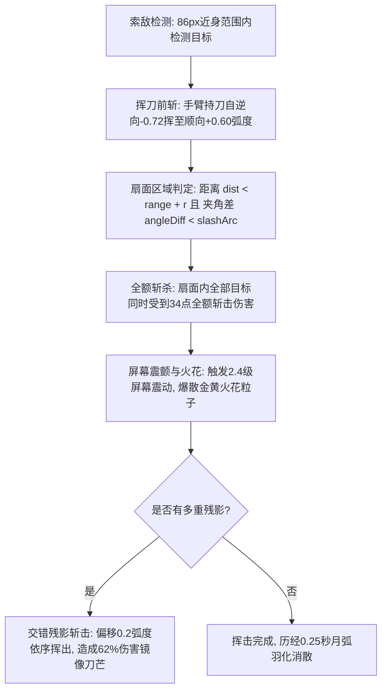

# 弧光太刀（Arc Katana）武器攻击设计说明

> 武器系列文档：[青玉剑](file:///Users/edy/myProject/aabbBox/设计说明/弹壳打工/青玉.md) · [回旋飞刃](file:///Users/edy/myProject/aabbBox/设计说明/弹壳打工/回旋飞刃.md) · [脉冲炮](file:///Users/edy/myProject/aabbBox/设计说明/弹壳打工/脉冲炮.md) · [弧光太刀](file:///Users/edy/myProject/aabbBox/设计说明/弹壳打工/弧光太刀.md) · [AK47](file:///Users/edy/myProject/aabbBox/设计说明/弹壳打工/AK47.md)

---

## 一、武器基本信息与卡片设计

| 属性维度 | 参数数值 / 设定 | 说明 |
| :--- | :--- | :--- |
| **武器标识 / 名称** | `katana` / **弧光太刀** | 近战高危高爆横扫类武器 |
| **战术定位** | **近战横扫 · 范围收割** | 近身全域真群伤，近距离怪物粉碎机 |
| **适配出战角色** | **巡游者**（温室巡游者） | 巡游者可选强攻型近战主武器 |
| **基础伤害** | **34 点** | 全武器单次面板最高基础伤害 |
| **攻击频率 / 挥刀间隔** | **0.62 秒/次**（约 1.61 次/秒） | 凌厉迅捷的近战连斩节奏 |
| **有效索敌射程** | **86 px** | 紧凑型近身防卫圈（贴脸近战） |
| **挥击形态** | **扇面等离子斩击** | 瞬发无飞行延迟，范围真群伤 |
| **初始斩击数量** | **1 道** | 升级后增加残影多重挥砍 |
| **初始斩击弧度** | **0.92 rad**（约 **105.4°** 扇面） | 大角度正面横扫弧面 |
| **动作硬直 / 屏幕震感** | 硬直 **0.23 秒**，屏幕震颤 **2.4 级** | 极强的打击重量感与屏幕受挫反馈 |

### 准备页卡片视觉规范
- **布局设计**：卡片顶端展示序号 `3 / 5`，底端为半透明黑底标签居中展示武器名 `弧光太刀`；左右切换箭头悬浮于卡片两侧。
- **武器图标**：
  - **流光刃身**：弧形太刀造型，刃身带有高亮橙金渐变烈火刃光（`#ff7418` → `#ffd21f` → `#fffdf0`）。
  - **刀镡与柄鞘**：深灰金属长柄，带有防滑纹理与倾斜 35° 的科技感刀镡护手。

---

## 二、战斗机制与循环流程

### 1. 全域真群伤机制（True AoE）
- 与绝大多数远程武器受限于“穿透数（Pierce Count）”不同，弧光太刀在判定扇面内**完全没有目标数量上限**。
- 无论是 3 只爬兽还是 30 只贴身孢子潮，只要进入扇面有效范围，均在同一帧结算 34 点致命斩击，属于被包围时的终极解围武器。

### 2. 残影连斩与衰减算法
- 初始斩击造成 100% 全额伤害（`s.damage`）。
- 升级【残影连斩】后，附加的残影在主斩击角度两侧以 $0.2 \text{ rad}$ 偏移相继挥出，造成 62% 的衰减伤害（`damage * 0.62`），两道斩击重合区域的敌人可承受高达 162% 的重叠爆发。

### 3. 屏幕震动反馈
- 每次有效挥刀命中时，触发游戏引擎级屏幕抖动 `G.shake = Math.max(G.shake, 2.4)`，带来拳拳到肉的打击震撼。

---

## 三、视觉与音效设计（VFX & Audio）

### 1. 特效表现（VFX）
- **战术攻击范围圈**：
  - 边界发光：金黄烈刃主题（`#ffd33d`，投影 `rgba(255, 211, 61, 0.42)`）。
  - 内环填充：浅金色微光（`rgba(255, 211, 61, 0.04)`）。
- **等离子月弧斩击结构**：
  1. **等离子炽光外层**：`#ff8a1f`，发光羽化 19px，线宽随生命期动态收缩（$15a + 5$）。
  2. **金黄锐利中层**：`#ffd83d`，高能锋线，线宽 $7a + 3$。
  3. **雪白刀锋内芯**：`#fffdf0`，极薄雪白高光核心（线宽 2.5px）。
  4. **外缘动态虚线弧与封门刻线**：`#fff0a3` 虚线伴随刀尖两侧向外延伸的封边刀芒。
- **挥砍动作联动**：角色持刀手臂在 0.23 秒硬直周期内从 `-0.72 rad` 极速挥动至 `+0.60 rad`。

### 2. 音效设计（Audio）
- **挥砍划空音**：1180Hz 锯齿波急速破空下落至 220Hz（持续 0.13s），伴随 540Hz 气流嗡鸣。
- **刀锋入肉音**：220Hz 金属方波重击下落至 90Hz，复合 760Hz 刀鸣正弦波，打击反馈清脆沉厚。

---

## 四、升级进化与突破路线

### 1. 武器专属强化分支

| 强化阶层 | 技能名称 | 强化效果说明 | 解锁条件 / 上限 |
| :--- | :--- | :--- | :--- |
| **专属基础** | **残影连斩** | 每次挥砍增加 **1 道** 残影（1 → 2 → 3） | 斩击数量上限 < 4 道 |
| **专属基础** | **月弧扩展** | 科技刀光角度 **+18%**（0.92 → 1.08 → 1.28 → 1.51 rad，最大约 **173°**） | 斩角上限 < 1.62 rad |
| **专属基础** | **高频刃长** | 太刀范围 **+24%**，伤害 **+10%**（86 → 106 → 132 → 164 px） | 范围上限 < 180 px |
| **超武突破** | **刃域共振** | 太刀伤害 **+15%**，攻击速度 **+6%**（发射间隔缩短至 94%） | 专属升级选满后开启 |

### 2. 通用协同增益建议
- **巡游步伐（移速 +18%）**：由于太刀射程较近，高移速能让角色自如穿梭在怪群边缘进行“拉扯斩击”。
- **纳米护甲（生命 +20）**：大幅增加近身贴怪时的容错率与肉度。
- **采集引力（吸附 +42%）**：怪物多死在身周近处，极大化经验吸收效率。
