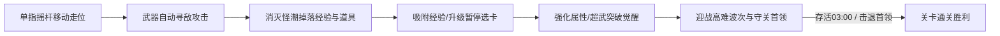

# 弹壳打工 · 游戏总体玩法与核心机制设计说明

本文件为《弹壳打工》（Core Breach Survival）的全局综合玩法设计说明，涵盖核心游戏循环、成长升级、掉落道具、操作交互及关卡波次等全局系统。各专属武器参数与技能请参阅对应武器文档。

> 关联文档：[设计说明首页/README](file:///Users/edy/myProject/aabbBox/设计说明/弹壳打工/README.md) · [青玉剑](file:///Users/edy/myProject/aabbBox/设计说明/弹壳打工/青玉.md) · [回旋飞刃](file:///Users/edy/myProject/aabbBox/设计说明/弹壳打工/回旋飞刃.md) · [脉冲炮](file:///Users/edy/myProject/aabbBox/设计说明/弹壳打工/脉冲炮.md) · [弧光太刀](file:///Users/edy/myProject/aabbBox/设计说明/弹壳打工/弧光太刀.md) · [AK47](file:///Users/edy/myProject/aabbBox/设计说明/弹壳打工/AK47.md)

---

## 一、核心玩法与游戏循环（Core Loop）

《弹壳打工》是一款轻度肉鸽生存割草（Roguelite Survival）游戏，以俯视角 2D 战场为核心舞台：

### 1. 基础控制与操作方式
- **移动控制（虚拟摇杆）**：全触控/鼠标支持，手指在屏幕任意位置按下即可呼出动态摇杆，提供 $360^\circ$ 无死角平滑位移控制。
- **自动攻击（Auto-Aim）**：武器系统根据自身攻击范围自动检索最近或威胁度最高的目标进行攻击，无需玩家手动瞄准发射。
- **主动脉冲技能（Active Skill）**：
  - **按键触发**：界面右下角设有主动技能按键（冷却时间 18 秒）。
  - **技能效果**：向角色四周释放超能高压脉冲光环，对范围内所有敌人造成 $300\%$ 武器基础伤害并击退突进敌群，伴随屏幕震颤与声浪反馈。

### 2. 界面视口与布局规范（严格竖屏）
- **首页操作按钮**：黄色“开始打工”按钮下方紧接同宽灰色“结束打工”按钮；点击“结束打工”退出游戏并返回工具首页。操作提示位于两个按钮下方。
- **显示模式**：全平台采用**严格竖屏（Portrait）**，手机端自适应宽度，桌面端居中保持手机竖屏比例（最大宽度 $500\text{px}$）。
- **战斗状态框**：位于关卡信息框下方、主战场上方，与关卡框采用相同背景、边框、圆角和宽度；左侧为暂停按钮，右侧为等级、计时、种子计数、生命与经验条。两个上方面板和战场之间均间隔 8px。小地图仍在战场右上角，尺寸 48×48 CSS 像素，上边距 10px、右边距 12px。音效开关位于暂停菜单，默认开启，文字按钮为“关闭音效 / 开启音效”。
- **主战场视口**：中央区域为正方形战场视口，尺寸固定为 **$500\text{px} \times 500\text{px}$**。
- **战场地图尺寸**：实际战斗场地尺寸为 **$1000\text{px} \times 1000\text{px}$**，边界设有能量防护围墙，镜头始终以角色为中心平滑跟随。
- **信息展示面板（紧凑贴合）**：
  - **主战场正上方**：依次展示关卡信息框（关卡名、所属区域、通关倒计时、波次进度条、当前波次说明、怪物血量难度倍率、击杀数）与战斗状态框（暂停、等级、计时、种子、生命与经验）。
  - **主战场正下方**：紧贴展示当前武器与属性面板（武器图标与职业说明、超武状态提示条、6 格属性矩阵【伤害、攻速、范围、弹道/剑柄数、穿透/打击次数、暴击率】、已选芯片列表）。

---

## 二、击杀掉落与等级成长体系（Exp & Leveling）

### 1. 经验掉落与数值
- **击杀奖励**：击败敌人必定掉落经验宝石：
  - **普通怪物**：掉落 1 枚荧光绿经验宝石（`value = 1`）。
  - **精英怪物**：掉落 1 枚高阶金黄经验宝石（`value = 1`），并在周围散落额外 11 枚金黄宝石（共计 12 枚经验点）。
- **采集引力圈（Magnet Radius）**：
  - 角色身周具备初始经验引力半径（基准 $75\text{px}$）。
  - 宝石进入引力圈后受磁力牵引飞向角色；接触距离 $\le 24\text{px}$ 时被角色吸收结算。

### 2. 等级提升公式
- **初始升级门槛**：角色第 1 级升至第 2 级需积累 **8 点** 经验。
- **逐级递增公式**：
  $$\text{NextExp}_{L+1} = \text{round}(\text{NextExp}_L \times 1.24 + 2)$$
- 升级瞬间暂停游戏主循环，呼出三选一强化卡片供玩家决策。

---

## 三、升级芯片体系与排序规范（Upgrades & Limit Break）

局内升级卡片分为**通用芯片**与**武器专属芯片**两大部分，并遵循严格的排序展示规范：

### 1. 通用芯片池（8 种）
| 芯片名称 | 简略效果展示 | 详细数值与定位 |
| :--- | :--- | :--- |
| **聚能校准** | `伤害 +30%` | 所有武器基础伤害 +30%（输出爆发） |
| **神经超频** | `攻速 +16%` | 所有武器攻击速度 +16%（发射间隔 $\times 0.84$） |
| **远距索敌** | `攻击范围 +20%` | 所有武器攻击范围 +20%（安全距离） |
| **巡游步伐** | `移速 +18%` | 角色移动速度 +18%（走位容错） |
| **纳米护甲** | `生命 +20` | 生命上限与当前生命值 +20 点（生存坦度） |
| **广域脉冲** | `脉冲范围 +26%` | 主动脉冲技能范围 +26%（群怪清屏） |
| **采集引力** | `吸附范围 +42%` | 经验吸附范围 +42%（资源收集） |
| **会心一击** | `暴击率 +10%` | 所有武器暴击率 +10%（暴击收益，上限 68%） |

### 2. 升级卡片展示排序规则
升级界面每次展示 3 张待选卡片，排序规则严格保证辨识效率：
1. **第 1 优先级（最前）**：**通用芯片**（如聚能校准、神经超频、会心一击等），始终排列在最前排。
2. **第 2 优先级（居中/后）**：**武器专属强化**（如青玉剑的万剑诀、灵剑回锋、青竹剑芒等），排在通用芯片之后。
3. **第 3 优先级（最后）**：**超武突破选项**，排在卡片末尾。

### 3. 第 4 卡位超武自动觉醒机制（Limit Break Bonus Slot）
- **触发条件**：当玩家达成武器核心觉醒前提时（例如青玉剑【万剑诀】累计升级 3 次后，后续升级有 $60\%$ 几率触发超武【大庚剑阵】：飞剑首击敌人脚下生成三圈交叉环绕剑阵（3圈共18把飞剑，外中内层层交叉错位旋转），持续 2 秒后慢慢隐藏）。
- **展示形态**：以**第 4 张独立金色卡片**的形式额外呈现于界面最下方。
- **自动激活与自选兼顾**：
  - 第 4 张超武卡片**自动勾选激活**（显示金色 SSR 背景与【★ 自动激活·赠送】勋章）。
  - **不消耗玩家的常规选卡名额**，玩家仍可在前 3 张卡中自由选择另外 1 项常规芯片，享受双重强化。
- **抽取限制**：当局游戏每种超武仅能突破生效 1 次。

### 4. 升级界面纯净展示规范（简略数据、无标签、无滚动条）
- **仅展示当前升级数据**：卡片上只呈现当前升级的数据变动（如 `伤害 +30%`、`飞剑 +2（当前 4 → 6柄）`、`首击敌人生剑阵`），简明直观，不添加冗长说明文本。
- **移除通用与武器名称文本标签**：卡片右侧已有武器/技能专属图标或半透明素材水印背景，无需重复展示“通用”或武器名称标签，视觉更清爽。
- **纯粹展示卡片**：升级弹窗去除顶部任何冗余标题、说明文字与关闭按钮，将全部视口空间让渡给强化卡片。
- **无滚动条完整露出**：移除卡片容器的纵向溢出滚动限制（`overflow: visible`、`max-height: none`、`scrollbar-width: none`），卡片在正方形战场视口中央整体垂直居中，无论 3 张常规卡片还是 4 张卡片（触发超武）均 100% 完整平铺展示。
- **底部装备面板标签折叠**：底部信息面板已选芯片栏自动对重复强化的卡片合并展示为 `芯片名 *n`（如 `聚能校准 *2`、`万剑诀 *3`）。

---

## 四、战场掉落道具机制（Battlefield Pickups）

击杀怪物除了掉落种子/经验点之外，还设有独立判定的**战场消耗道具掉落系统**：

| 道具标识 | 道具中文名 | 掉落概率 | 内置冷却（CD） | 拾取生效规则与数值口径 | 外观与视效表现 |
| :--- | :--- | :--- | :--- | :--- | :--- |
| `magnet` | **磁铁** | **5%** | **20.0 秒** | 角色碰撞拾取后，**立即吸附并捡取全地图所有现存经验点**。所有经验宝石获得吸附标记，以 $420 \sim 600\text{px/s}$ 超高速直奔玩家并逐个结算升阶 | 悬浮马蹄形双极磁铁（红/蓝双色与白银磁极），伴随金色脉冲能量光环与周围电弧微粒；拾取迸发金色冲击波与 `🧲 全图吸附!` 提示浮字 |
| `medkit` | **血包** | **5%** | **20.0 秒** | 角色碰撞拾取后，**恢复角色最大生命值的 10%**（**严格向上取整**：`Math.ceil(maxHp * 0.1)`），生命值上限封顶 | 悬浮战地医疗箱（圆角手提箱与醒目红十字），伴随翠绿生机光环波动；拾取迸发翡翠治愈涟漪并浮现 `+X HP` 绿色治愈数值 |

### 道具通用运作规则
1. **内置独立冷却**：磁铁与血包各自维护独立的 **20 秒掉落冷却计时**（`magnetDropCd` / `medkitDropCd`）。道具掉落瞬间开始倒计时 20 秒，冷却期间击杀怪物不会再次掉落同类道具。
2. **永久驻留与多件累积**：掉落后**不会因为超时而消失**，未拾取时永久留在地图上；全图可以**同时累积存在多个**血包与磁铁。
3. **触碰拾取防护**：掉落道具独立于角色的“采集引力”吸附圈（防止未受伤或低经验时意外误吸浪费），必须角色本体靠近（碰撞判定距离 $\le 28\text{px}$）主动踏过拾取。
4. **小地图雷达专属标记**：当战场上出现掉落道具（磁铁或血包）时，右上角小地图（雷达）上会自动标注醒目的金色**小五角星标记**（伴随微光呼吸律动），方便玩家在广阔战场中快速定位掉落道具方位前往拾取；角色接触拾取后，雷达上的小五角星标记即刻消除。

---

## 五、关卡场景与首领战机制（Stages & Encounters）

游戏当前以 5 张主题地图循环组成 100 关，共 20 轮；各关卡均以存活 180 秒判定胜利，击杀首领不会提前通关。每轮依次为温室、草原、沙海、街区、洞窟，第 6 关回到温室，第 100 关为洞窟。首页可通过箭头、滑动或键盘选择 1–100 关；第 1、100 关为端点。首页标题为“纯数字编号 + 关卡名称”，不显示独立关卡输入、轮次/血量说明及选配介绍。

每进入下一轮，所有普通怪和首领的基础生命乘以 1.2。关卡 `N` 的循环倍率 `C=1.2^floor((N-1)/5)`；第 1–5 关为 1，第 6–10 关为 1.2，第 11–15 关为 1.44，第 96–100 关约 31.948。完整选择、成长和通关规则见 [百关循环机制](机制_百关循环.md)。

| 关卡序号 | 场景标识 | 关卡名称 | 关卡目标 | 守关首领 | 战术应对重点 |
| :--- | :--- | :--- | :--- | :--- | :--- |
| **第 1 关** | `greenhouse` | **荧光温室** | 存活 03:00 | **母巢花冠** | 孢子持续追击，善用脉冲技能拉开距离，利用回旋/贯穿武器清理怪群 |
| **第 2 关** | `grassland` | **风痕草原** | 存活 03:00 | **古木巨角** | 快速追击单位较多，需注重走位机动性（巡游步伐）与中远距离放风筝 |
| **第 3 关** | `desert` | **灼风沙海** | 存活 03:00 | **日蚀沙王** | 高生命甲壳单位较多，注重叠高穿透打击与暴击率，尽早突破超武以获得爆发清怪能力 |
| **第 4 关** | `district` | **零号街区** | 存活 03:00 | **重装融合体** | 持续追踪的感染体形成围堵，保持移动，善用血包留存与磁铁全图收集经验 |
| **第 5 关** | `cave` | **幽晶洞窟** | 存活 03:00 | **晶脉岩王** | 20 秒后晶甲虫占普通刷怪的 24%；优先清理快追的洞蝠，保留矿轨两侧的绕行空间，详见 [地图设计](地图_幽晶洞窟.md) |

### 首领遭遇战规则
- **波次难度倍率**：出生生命为 `基础生命 × C × (1 + G.time / 220) × H`；`C` 为百关循环倍率（`G.stageHpScale`），`H` 为首页选择的生命倍率（`G.enemyHpScale`，默认 1）。循环只增加生命，移速、接触伤害、刷怪比例和经验掉落保持对应地图的原配置。刷怪间隔仍随局内时间缩短。
- **精英/首领登场**：游戏时间首次超过 60 秒时生成一只首领并显示文字警报；首领沿用追踪与接触伤害规则，具备大体型碰撞盒与高额血量。
- **胜利判定**：游戏时间达到 180 秒时胜利；击杀首领仅获得掉落与击杀提示，不提前结算。
- **连续闯关**：通关 1–99 关后，结算主按钮进入下一关；失败时重试当前关。通关第 100 关显示“百关完成”，可重试第 100 关或返回准备页，不生成第 101 关。新的一关仍从初始生命、武器属性和零经验开始，局内强化不跨关保留。

洞窟当前已实现独立封面、岩层地面、晶簇、积水、矿轨、矿灯以及四类生物的动作绘制。场景装饰不参与碰撞；落石、黑暗视野限制、毒液、首领震地等机制尚未实现。
