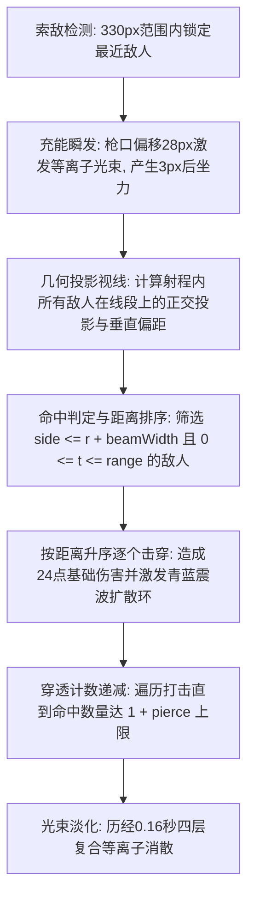

# 脉冲炮（Pulse Blaster）武器攻击设计说明

> 武器系列文档：[青玉剑](file:///Users/edy/myProject/aabbBox/设计说明/弹壳打工/青玉.md) · [回旋飞刃](file:///Users/edy/myProject/aabbBox/设计说明/弹壳打工/回旋飞刃.md) · [脉冲炮](file:///Users/edy/myProject/aabbBox/设计说明/弹壳打工/脉冲炮.md) · [弧光太刀](file:///Users/edy/myProject/aabbBox/设计说明/弹壳打工/弧光太刀.md) · [AK47](file:///Users/edy/myProject/aabbBox/设计说明/弹壳打工/AK47.md)

---

## 一、武器基本信息与卡片设计

| 属性维度 | 参数数值 / 设定 | 说明 |
| :--- | :--- | :--- |
| **武器标识 / 名称** | `blaster` / **脉冲炮** | 巡游者初始绑定的高能等离子手炮 |
| **战术定位** | **中程爆发 · 瞬发光径** | 狙击型瞬间贯穿，单次伤害高 |
| **适配出战角色** | **巡游者**（温室巡游者） | 巡游者出战默认绑定的主战武器 |
| **基础伤害** | **24 点** | 高额单发基础伤害，前期清怪利器 |
| **攻击频率 / 发射间隔** | **0.78 秒/次**（约 1.28 次/秒） | 蓄能后重炮轰击节奏 |
| **有效索敌射程** | **330 px** | 覆盖大半战场的直线中程火力 |
| **光束速度** | **即时（Instant Hitscan）** | 射线判定，发射即命中（存在 0.16s 视觉留存） |
| **初始射线数量** | **1 道** | 升级后可扩展为多路并射矩阵 |
| **初始穿透次数** | **0 次**（单体命中） | 升级【棱镜贯穿】后可直线穿透打击多个敌人 |
| **射线初始宽度** | **4 px** | 实际碰撞宽度为自身线宽加上怪物受击半径 |
| **发射枪口偏移** | **28 px** | 枪口伸出点激发光束，伴有青蓝电浆火花 |
| **动作硬直 / 后坐力** | 硬直 **0.14 秒**，后坐力 **3 px** | 武器后挫震颤与枪口充能发光联动 |

### 准备页卡片视觉规范
- **布局设计**：卡片顶端展示序号 `2 / 5`，底端为半透明黑底标签居中展示武器名 `脉冲炮`；左右切换箭头悬浮于卡片两侧。
- **武器图标**：
  - **枪身外壳**：斜切流线科技轻质装甲，渐变紫蓝等离子电镀（`#c4ccdc` → `#7865db` → `#372b67`）。
  - **充能电容**：前端暗金属散热管口（`#263c48`），枪侧带有幽蓝高亮聚能晶体。

---

## 二、战斗机制与循环流程

### 1. 瞬发射线几何解算（Hitscan Math）
- **投影计算**：光束起点 $(x_1, y_1)$，方向角为 $\theta$。对射程内任一敌人 $(e_x, e_y)$：
  - 沿射线轴向距离：$t = (e_x - x_1)\cos\theta + (e_y - y_1)\sin\theta$
  - 垂直射线侧偏距：$\text{side} = |(e_x - x_1)\sin\theta - (e_y - y_1)\cos\theta|$
- **命中准则**：当且仅当 $0 \le t \le \text{range}$ 且 $\text{side} \le e_r + \text{beamWidth}$ 时判定为有效命中。
- **穿透优先权**：所有满足条件的敌人按照轴向距离 $t$ 升序排列，光束自近向远依序贯穿，最多结算 $1 + \text{pierce}$ 个敌人。

### 2. 多束分流与散射（Beam Matrix）
- 升级【分束矩阵】后，多道射线以 $0.085 \text{ rad}$ 的微幅发散角同时喷发，每道射线独立执行碰撞与穿透计算，实现正面大范围火力洗地。

---

## 三、视觉与音效设计（VFX & Audio）

### 1. 特效表现（VFX）
- **战术攻击范围圈**：
  - 边界发光：蔚蓝脉冲光芒（`#68cfff`，投影 `rgba(104, 207, 255, 0.38)`）。
  - 内环填充：极淡等离子蓝辐射（`rgba(104, 207, 255, 0.032)`）。
- **四层复合光束结构**：
  1. **最外层广域光晕**：`#4a65ff`，模糊半径 18px，`lighter` 柔光叠加。
  2. **次外层离子光柱**：`#68d7ff`，线宽为 $\text{beamWidth} + 3$。
  3. **核心极亮白光芯**：`#f4fdff`，极高对比能量中心。
  4. **动态流动虚线光纹**：`#d8f8ff`，随发射时间与随机相位高速向前喷涌的点状流光。
- **受击光环（Ripples）**：每个命中点爆散青蓝同心扩展光环（`rgba(105, 196, 255, alpha)`，最大扩散半径 20px）。
- **枪口火花**：击发瞬间枪口激射 7 颗青蓝电火花粒子（`#8edcff`，初速 72px/s）。

### 2. 音效设计（Audio）
- **发射充能音**：180Hz 锯齿波急速升频至 780Hz（持续 0.13s），复合 720Hz 正弦波双频啸叫，科技能量释放感极强。
- **命中消解音**：125Hz 能量重低音沉底，搭配 540Hz 高频电浆碎裂声。

---

## 四、升级进化与突破路线

### 1. 武器专属强化分支

| 强化阶层 | 技能名称 | 强化效果说明 | 解锁条件 / 上限 |
| :--- | :--- | :--- | :--- |
| **专属基础** | **分束矩阵** | 脉冲炮额外发射 **1 道** 射线（1 → 2 → 3 → 4） | 射线数量上限 < 5 道 |
| **专属基础** | **过载光径** | 射线宽度 **+3 px**，伤害 **+12%** | 宽度上限 < 16 px |
| **专属基础** | **棱镜贯穿** | 射线额外贯穿 **2 个** 目标（1 → 3 → 5 → 7） | 贯穿上限 < 8 次 |
| **超武突破** | **反应堆过载** | 脉冲伤害 **+15%**，攻击速度 **+6%**（发射间隔缩短至 94%） | 专属升级选满后开启 |

### 2. 通用协同增益建议
- **致命镜面（暴击 +10%）**：脉冲炮基础单发高达 24 点伤害，暴击后可打出 48+ 点毁灭伤害，精英怪亦可瞬间残血。
- **远距索敌（范围 +20%）**：光束长度由 330px 延展至 396px，真正实现“超视距”贯穿狙击。
- **神经超频（攻速 +16%）**：有效弥补脉冲炮 0.78s 射击硬直较长的短板。
