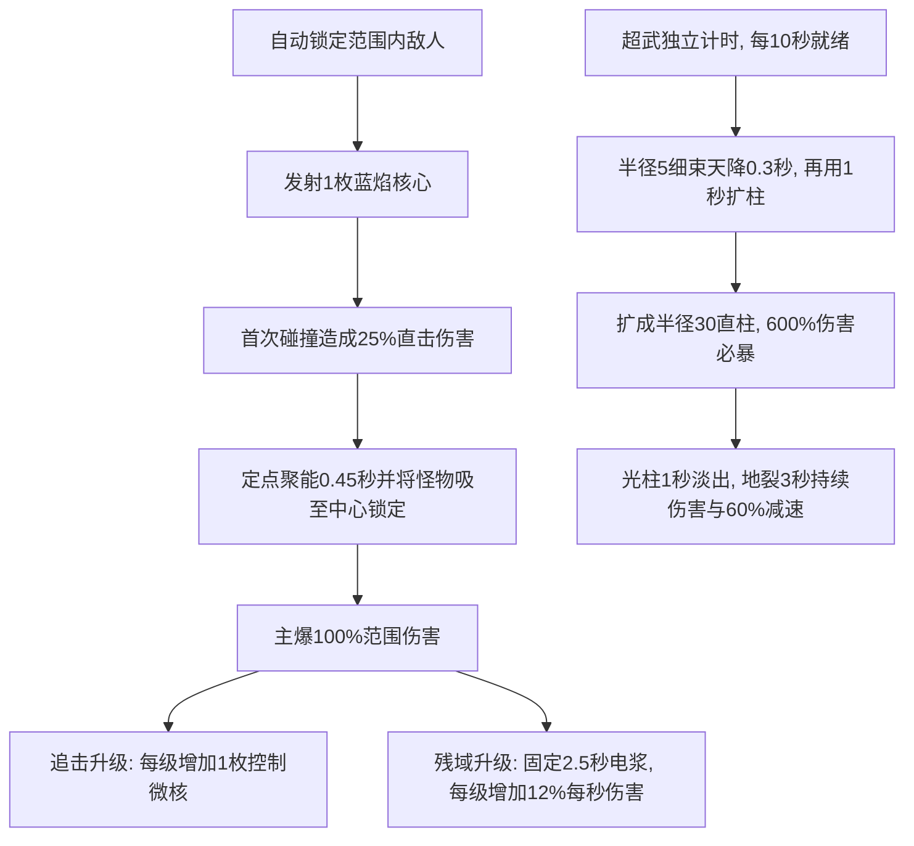

# 零域脉冲炮武器攻击设计说明

> 关联文档：[总体玩法与核心规则](总体玩法.md) · [青玉剑](青玉.md) · [幽月回刃](幽月回刃.md) · [零域脉冲炮](零域脉冲炮.md) · [弧光太刀](弧光太刀.md) · [AK47](AK47.md)

> **当前实现（2026-10-15）：** 磁暴聚爆、三条等量成长升级与天降极光超武“零域·磁极坍缩”已接入。本文按当前代码整理，目录与青玉剑保持一致。正式名称为“零域脉冲炮”，原名“脉冲炮”；代码标识`blaster`、素材文件名和制作记录目录保持稳定。

---

## 一、武器基本信息与卡片设计

基础属性以未选强化的新开局为准；时间为游戏模拟秒，暂停及选卡时不推进；射程、核心尺寸与伤害范围使用世界像素，人物缩放0.6仅作用于角色与手持绘制。伤害内部保留小数，界面按Math.round显示。

| 属性维度 | 参数数值 / 设定 | 说明 |
| :--- | :--- | :--- |
| **武器名称 / 标识** | `blaster` / **零域脉冲炮** | 巡游者初始绑定的高能等离子手炮 |
| **战术定位** | **中程爆发 · 磁暴聚爆** | 自动发射、定点牵引、延时范围爆炸 |
| **适配出战角色** | **巡游者**（温室巡游者） | 巡游者出战默认绑定的主战武器 |
| **基础伤害** | **24 点基准D** | 直击0.25D＋主爆1.00D；单目标全中合计30点，暴击另算 |
| **攻击频率 / 发射间隔** | **1.00 秒/轮**（1轮/秒） | 专属升级不改变主核心发射间隔；通用攻速正常生效 |
| **有效索敌射程** | **330 px** | 覆盖大半战场的直线中程火力 |
| **主核心航速／碰撞半径** | **620px/s／6px** | 实体直线弹，连续线段检测首个碰撞目标 |
| **主核心数量** | **1枚／轮** | 始终1枚；追击升级只增加主爆后的微核数量 |
| **聚能时长** | **0.45秒** | 碰撞后在该位置悬停聚怪，之后自动爆炸；不穿透 |
| **初始聚怪与主爆半径** | **64px** | 每级扩容＋16px，三级为112px；索敌范围不等于爆炸范围 |
| **吸附与锁定** | **0.12秒吸至磁场中心** | 普通怪、精英、首领均受控；磁场存在期间禁止自主移动 |
| **磁场持续时间** | 普通0.45秒、微型0.45秒 | 超武另为3秒减速区域，不吸附或锁定 |
| **发射枪口偏移** | **28 px** | 枪口伸出点发射实体核心，伴有青蓝电浆火花 |
| **开火表现 / 后坐力** | **0.14 秒**，后坐偏移 **3模型像素**（1.8世界像素） | 仅为绘制表现，不限制移动；后坐偏移以30模型像素/s回正 |

### 战场攻击范围显示

- 参照青玉剑，始终在角色脚下绘制 **冰蓝（`#68cfff`）** 范围圈，默认半径 **330 个世界像素**；逐帧读取当前 `G.stats.range`，范围强化后同步扩大，不受角色 `MODEL_SCALE=.6` 缩放影响。
- 使用淡色填充、发光边界、流转虚线、四向刻度与朝向弧光，绘制在角色、敌人和弹体下方；敌人进入圈内或攻击时增强亮度。
- 实际半径超过视口可容纳的半径时，保留真实范围圈，额外显示角色中心的内收虚线提示圈（半径 `max(24, min(width,height)/2 - 20)`），并标注“射程 数值 · 超出视野”。此提示圈不代表伤害边界；数值按当前范围四舍五入显示。范围完整可见时不显示文字。
- 范围圈说明基础索敌距离；实际弹道、太刀扇面、飞剑追击与命中体积判定仍按各武器战斗规则执行。显示由 Canvas 实时绘制，无新增图片素材。详见 [总体玩法](总体玩法.md#攻击范围显示)。

### 准备页卡片视觉规范

- **布局设计**：卡片顶端展示序号 `2 / 5`，底端为半透明黑底标签居中展示武器名 `零域脉冲炮`；左右切换箭头悬浮于卡片两侧。
- **武器图标**：
  - **造型**：保持方形一体厚盒轮廓，取消外置握把和外凸护圈；炮体内部下缘使用低矮浅横槽和小型紫色弯扳机，扳机区高度压至前一稿约一半；上下两层横向等长，在前端同一平面齐平，连续底框不再向下外伸。画布仍为用户确认的横向3、纵向2比例。银白顶部亮面、深蓝侧面与底面、方形内凹炮口的厚边体现立体感；保留单个冰蓝矩形核心与紫色后端色块，继续使用粗描边及少量大色块，减少碎小装饰。炮口轴线保持水平向右，轻微侧视厚度不改变瞄准方向。
  - **主色**：银白、深蓝、冰蓝，少量紫色；准备页使用蓝灰到深蓝径向渐变（`#4c789c → #183653`），突出白色装甲与能量核心。
  - **当前素材**：`frontend/素材库/弹壳打工/weapons/blaster-tech-low-profile.png`，1536×1024 RGBA，原图真实透明，四角及扳机护圈开口alpha为0；准备页、升级卡背景大图与小图、装备栏和局内手持复用同一文件。
  - **元数据**：`frontend/素材库/弹壳打工/weapons/blaster-tech-low-profile.json`，记录生成来源、哈希、透明边界、方向和炮口锚点。原图未裁切或重绘；旧`blaster.svg`、圆润初稿`blaster-tech-cartoon.png`、纯盒式稿`blaster-tech-box.png`、外置握把稿`blaster-tech-trigger.png`与较高底框稿`blaster-tech-integrated.png`（含其JSON）保留作历史素材，当前游戏不再引用。
  - **来源与制作记录**：内置imagegen原创生成，无外部图片；完整提示词与实际游戏预览位于`离线素材库/弹壳打工/制作记录/脉冲炮/`。

### 局内手持与开火表现

- 炮体画布宽56模型像素，人物按`MODEL_SCALE=0.6`缩放后为33.6世界像素；3:2画布显示高约22.4世界像素；高宽比例沿用原PNG。枪口锚点为源图`(1410,500)`，绘制时对齐朝向上的28世界像素发射位置。开火时仅炮体产生原有后坐偏移，核心的发射起点保持28px。
- 两个角色均复用当前持枪手臂，后手伸入炮体内部扳机孔左缘，模型手心为`(5,5.5)`；前手托住平整底框，手心为`(31,10)`；手指避开紫色扳机，保留内部开孔轮廓；朝左时沿局部纵轴镜像，使上下装甲保持相同朝向。上下射击仍跟随实际朝向旋转；向上射击时炮体和手臂位于身体后方，避免遮住角色面部。
- 开火后0.14s内，炮口叠加短促冰蓝闪光，随动作时间淡出；实体核心、定点磁场和主爆取代原四层瞬发光束。炮体发射仍无动作延迟；新增实体核心离开枪口后飞行与定点聚能，伤害不再瞬发。
- PNG未加载或请求失败时，以Canvas绘制银白顶部亮面、深蓝厚度侧面、冰蓝矩形核心、连续方形底框、透明内部开孔、紫色扳机与方形发射面的简化后备造型，不阻断战斗。

---

## 二、战斗机制与循环流程

### 1. 普通攻击、吸附与锁定

- 自动选择玩家索敌范围内最近敌人，每轮发射1枚实体核心，航速620px/s、碰撞半径6px，不穿透、不追踪；蓝色火箭喷焰随弹体朝向绘制。
- 首次碰撞结算`0.25D`直击并在碰撞位置悬停。达到射程尽头或围墙时也在最后合法位置聚能；目标提前死亡不丢失该枚核心的爆炸。
- 主磁场持续0.45秒；范围内普通怪、精英、首领约0.12秒内平滑吸至中心，磁场有效期间不能自主移动。重叠时绑定最近一片，原场结束后若处于其他有效场内则接续控制。遵守地图边界，不赋予玩家接触免伤，接触伤害通常仍生效；时间停止期间全部敌人停止移动和接触伤害，磁场不能将其拉动，但仍会到期爆炸。
- 聚能结束结算一次`1.00D`范围主爆，随后按本轮已解锁等级产生微核与电浆。磁场半径为`R=64+16×磁场扩容等级`，每级仅扩大半径，不增加主爆伤害。
- 所有属性在本轮发射时快照保存，升级不追溯改动在途核心。每轮间隔使用当前基础T，专属升级不再附加双核心、伤害折算或间隔惩罚。

### 2. 追击微核与电浆残域

- **裂核追击**：每级固定增加1枚微核，0／Ⅰ／Ⅱ／Ⅲ级分别为0／1／2／3枚。单枚伤害始终`0.30D`，爆炸半径28px，航速720px/s，搜索范围160px，最长飞行0.60秒。
- 微核优先追击主爆范围外的存活敌人，多枚优先分配不同目标，目标不足时可集火。只对选定目标执行直接碰撞，不在途中其他敌人身上提前爆炸；目标死亡可重新寻敌。命中后结算一次小爆炸，并在目标位置留下半径28px、持续0.45秒的小型控制磁场，控制规则与主场一致。
- 小磁场本身无额外伤害，不产生新微核、电浆或其他递归事件。失去目标、飞行超时或撞墙造成的空爆不生成小磁场。
- **电浆残域**：主爆后在原位置留下一片持续2.50秒的电浆，半径始终为所属核心R的65%。每级固定增加`0.12D/s`，Ⅰ／Ⅱ／Ⅲ级分别为`0.12D/s`／`0.24D/s`／`0.36D/s`；结束时自然消失，无额外放电。
- 电浆持续伤害不暴击；重叠时只取最强一片，按实际停留时间累计小数伤害，约每0.50秒结算一次，离开或区域失效时结清余量。主爆与微核的瞬时伤害正常判定暴击。

### 3. 超武突破：零域·磁极坍缩

**半径5的细束用0.3秒从天而降，随后用1秒扩成半径30的笔直蓝白光柱，在扩柱完成时结算必定暴击，随后留下3秒深蓝地裂区域。** 超武不经炮口发射，不替换普通核心，也不等待下一轮开火。

| 项目 | 当前规则 |
| --- | --- |
| 获取 | 三条路线各Ⅱ后，下一次升级额外赠送第四张金卡；每局一次 |
| 独立触发 | 觉醒后立即就绪；有合法目标时自动召唤，从召唤时起冷却10.00秒，攻速不缩短冷却 |
| 无目标 | 保留一次就绪，不累计多次；目标出现后才召唤 |
| 落点与范围 | 索敌范围内首领、精英、最近敌人依次优先；锁定召唤时地面坐标。瞬间伤害与光柱半径固定30世界像素；持续伤害、60%减速与地面坍缩半径为`1.5R`，R为普通聚能黑洞半径，随扩容成长为96／120／144／168。两类特效分别按对应半径绘制并裁切，不增加实线标注圆；敌人碰撞圆接触外沿即命中，圆完全在外不命中 |
| 扩柱过程 | 第一阶段半径固定5，光束头部从上方下降，0.30秒触地；第二阶段用1.00秒向两侧扩成半径30，两边笔直平行，不使用波浪光帘。总计召唤后1.30秒结算瞬间伤害，此前无伤害或减速 |
| 瞬间伤害 | 扩柱完成时在半径30内一次600%基础伤害（6D），必定获得当前倍率M的暴击；再按当前暴击率独立判定一次额外×M暴击。合计6D×M，额外暴击成功为6D×M²；初始M=2时分别12D／24D |
| 暴击卡片 | 当前暴击率含初始8%及“会心一击”每张＋10个百分点（上限68%）；同时每张使暴击伤害增加25个百分点，初始200%→225%→250%，提高极光两次暴击倍率；不重复无限叠乘。必暴显示`!`，额外暴击显示`!!` |
| 持续伤害 | 扩柱完成后在半径1.5R的地面区域内持续3.00秒，每秒100%基础伤害（1D/s），不暴击；约每0.50秒结算，离开或结束时结清小数余量；可与普通电浆独立叠加 |
| 区域减速 | 同一3秒内敌人移速降至40%（减速60%），离开即恢复；不聚怪、不吸附、不禁止自主移动。普通核心或微核的独立控制仍可在重叠区域生效 |
| 光束淡出 | 扩柱完成后1.00秒内渐变透明并消失；地面坍缩、持续伤害与减速继续到3秒结束 |
| 地面表现 | 扩柱完成时出现普通聚能黑洞1.5倍半径的蓝紫破坏坍缩PNG：保留用户参考的电浆与青蓝电光裂隙，增加断裂石板、暴露土层、下陷断面及碎石；裁切在实际持续伤害半径内，不增加实线圆或吸入流光；整体40%不透明度，最后0.35秒地面淡出。光柱整体蓝白色，两边黄色发光，辉光位于柱体半径以内；不透明度固定60%（alpha=0.6），最后1秒从60%淡出至0 |
| 结算边界 | 不产生微核或电浆，区域结束无追加伤害；普通射击可同时进行 |

D在召唤时快照，暴击概率与倍率在命中时读取当前卡片属性；后续升级、目标移动或死亡不改变已锁定落点与基础伤害。暂停及选卡冻结扩柱、淡出、区域和冷却；结束、换关、重开清理全部效果及待结算伤害，不补发伤害。

### 4. 伤害参考

D为本轮基础伤害，下面以初始D=24、除超武必暴外不计随机暴击和通用强化举例。基础直击＋主爆全中同一目标为30点，其他范围内敌人只受24点主爆。

- 追击Ⅰ／Ⅱ／Ⅲ级，每枚微核7.2点；普通一轮全链命中同一存活目标为37.2／44.4／51.6点，不含电浆。
- 残域Ⅰ／Ⅱ／Ⅲ级，每秒2.88／5.76／8.64点，单片完整2.5秒命中为7.2／14.4／21.6点；目标离开或区域重叠时不能按完整单片数量直接相乘。
- 天降极光：600%基础伤害为144点，必定暴击后288点；额外暴击触发时576点。后续每秒24点，完整3秒72点；瞬间半径固定30，地面持续伤害半径1.5R（扩容Ⅱ为144，Ⅲ为168），与普通射击独立结算。

---

## 三、视觉与音效设计（VFX & Audio）

### 1. 特效表现（VFX）

| 部分 | 设计表现 | 素材或制作方式 |
| --- | --- | --- |
| 手持炮体 | 沿用已确认的方形一体、低矮内嵌扳机造型 | 复用`frontend/素材库/弹壳打工/weapons/blaster-tech-low-profile.png` |
| 发射动作 | 双手托炮、短促后坐与蓝色枪口喷焰；移动不中断 | 复用当前动作，Canvas绘制蓝色喷火 |
| 主核心 | 17px宽方核，后方拖出蓝色火箭喷焰，白蓝内焰与蓝色外焰随模拟时间脉动 | 主体复用攻击图集；喷焰、拖尾与火星由Canvas绘制 |
| 聚能黑洞 | 普通攻击命中后展开蓝色黑洞：图片按2R尺寸绘制并裁切在R内，光晕铺至边缘，不叠加实线范围圆；保留深黑视界、旋转盘与内收流光，爆炸后收缩 | 新增透明黑洞PNG，Canvas驱动旋转、展开与收缩；纹理裁切范围与实际聚怪／主爆半径一致，无实线圈 |
| 主爆 | 冰蓝短弧冲击波，0.24秒淡出，不叠加完整实线圆 | Canvas实时绘制；主爆伤害一次结算，不因扩散重复命中 |
| 微核 | 10px方核带较短蓝色喷焰，追踪命中后展开小型蓝色磁场控制敌人 | 复用微核精灵与黑洞PNG，动态绘制喷焰与28px范围边界 |
| 电浆残域 | 深蓝低透明圆形电浆面，紫色游弧；到期自然淡出，不遮住敌人脚底 | 攻击图集纹理裁切在实际半径，保留低亮底色，移除实线外沿及计时圆弧，不绘制牵引线 |
| 天降极光 | 半径5细束下降0.3秒，再用1秒扩成半径30蓝白直柱，两侧黄色辉光，60%不透明度；满宽时暴击，1秒淡出，地面1.5R碎裂坍缩PNG持续3秒 | 光柱与落点提示由Canvas绘制；地面使用新增透明破坏坍缩PNG，图片失败时使用碎裂石板与裂纹后备 |

- 黑洞与电浆在敌人下方绘制；聚能阶段不再叠加原来的小方核与方框，飞行核心和微核仍在敌人上方显示。黑洞图片失败时绘制深黑视界与三条蓝色旋臂后备，不阻断战斗。
- 黑洞为普通攻击自带表现，无需升级：在原0.45秒聚能期间展开，纹理以1.44rad/s旋转（原4.8rad/s的30%），普通聚能与爆后收缩均不绘制外围虚线范围圆；主爆后0.14秒内收缩，主爆扩散环仍于0.24秒内淡出。天降极光扩柱后留下3秒蓝紫破坏坍缩素材，减速60%且不吸附；追击命中仍留下0.45秒控制小磁场。极光每10秒独立召唤，普通射击照常进行。
- 超武就绪时手持炮体增加亮蓝核心高光；装备栏显示三条路线等级、主核心数量与坍缩冷却，不增加资源操作条。
- 战术范围圈统一使用冰蓝`#68cfff`，表示索敌范围；普通、微型磁场与超武地面素材按各自实际半径裁切，普通磁场已移除外围虚线圆；技能区域无额外实线标注圈。完整显示规则见第一章。

### 2. 音效设计（Audio）

复用现有程序合成音效：发射为短促能量音，普通主爆和极光落地为低频命中音，极光召唤先有540Hz升至1100Hz的短蓄能音；微核不单独叠加一份主爆音。普通主爆震屏1.2、坍缩3，均按原震屏系统衰减。

### 3. 素材路径与来源

- 新攻击图集：`frontend/素材库/弹壳打工/effects/blaster-magnetic-atlas.png`，1254×1254 RGBA，2×2透明图集，依次为主核心、追击微核、电浆残域及历史坍缩核心；当前使用前三格，最后一格保留作历史素材。原图直接复制，没有改色或重新压缩；同名JSON保存来源、哈希及各精灵源矩形，代码裁取源矩形绘制，不加载四张重复图片。
- 内置imagegen原创生成；SHA-256为`f643db1c220bbb982df746a5753325b1d620d6a57764d2c4ec2025968cf0901e`。四角alpha均为0，透明通道已检查。提示词见`离线素材库/弹壳打工/制作记录/脉冲炮/磁暴攻击图集提示词.txt`。
- 蓝色黑洞素材：`frontend/素材库/弹壳打工/effects/blaster-blue-black-hole.png`，1254×1254 RGBA，四角alpha为0、中心深色视界保留；内置imagegen原创生成，原图未改色或重新压缩。同名JSON记录源矩形、来源及SHA-256，提示词与预览保存在`制作记录/脉冲炮/`。
- 新增破坏坍缩：`frontend/素材库/弹壳打工/effects/blaster-collapse-ruined-ground.png`，1254×1254 RGBA，用户提供蓝紫电浆参考，内置imagegen编辑生成，原图直接复制，未改色或重新压缩。四角alpha=0，中心alpha=251，运行时裁取`(72,54,1113,1112)`并按实际直径2R绘制。SHA-256：`c2b27e217a141d581b0a308714dcb14ea11452bba9afa3bb0e9e9562b099b052`；同名JSON记录来源、透明检查与源矩形。参考副本为`制作记录/脉冲炮/坍缩电浆用户参考.png`，完整提示词见`地面破坏坍缩素材提示词.txt`。地面整体不透明度为40%（alpha=0.4），叠乘最后0.35秒的淡出；不修改源PNG，地面不旋转，避免石板漂移。
- 当前炮体仍使用`frontend/素材库/弹壳打工/weapons/blaster-tech-low-profile.png`及同名JSON，制作记录目录沿用`制作记录/脉冲炮/`。旧炮体稿仅作历史保留，正式素材入口见第一章。
- 战斗模块：[core-breach-blaster.js](../../frontend/src/core-breach-blaster.js)；页面接入：[core-breach-game.html](../../frontend/src/core-breach-game.html)。前者管理核心、牵引、微核、电浆、极光、减速、暴击倍率、快照与清理，后者负责角色、扣血、掉落、音效及选卡。
- 来源、提示词和实机预览见[素材库说明](../../frontend/素材库/弹壳打工/README.md)与[制作记录](../../离线素材库/弹壳打工/制作记录/脉冲炮/README.md)。新增图片、帧、图集与元数据统一归入本游戏素材目录，提示词及预览放入制作记录。

### 4. 验证记录与当前限制

- `frontend/tests/core-breach-blaster.test.cjs`的26项规则测试、通用与时停8项，以及飞刃／关卡25项已有测试，合计59项通过。
- 当前验证覆盖三路线每级相同增量、半径64／80／96／112、微核0／1／2／3、固定2.5秒电浆与12%递增、主核心数量／伤害／间隔不被专属升级改变，及中心控制、重叠场接续、微核追击、小磁场、持续伤害余量与帧率一致性。
- 极光验证覆盖不射击也能独立触发、首领优先落点、0.3秒半径5天降＋1秒扩柱前无伤害、固定瞬间半径30／地面1.5R、边缘内外判定、笔直黄边光柱与60%不透明度、素材源矩形／哈希、无实线圈绘制、召唤伤害快照、600%必暴与额外暴击、3秒持续伤害与60%减速、无吸附、与电浆独立叠加、10秒冷却保留、暂停冻结、结束／重开清理。
- 浏览器实际点击六次专属卡验证配方赠送，核对新版超武卡片；确认扩柱期间无伤害、必暴288点、额外暴击576点、1秒后光束消失、减速时敌人仍可移动且不被吸附，结束后移速恢复。320／390／1280px无脚本错误或水平溢出，黑洞图片失败时后备有效。
- 当前预览保存于`离线素材库/弹壳打工/制作记录/脉冲炮/`：`破坏坍缩_细束天降预览.png`、`破坏坍缩_半透明光柱扩展预览.png`、`破坏坍缩_半径30光柱落地预览.png`、`柔和坍缩_地面碎裂手机预览.png`、`柔和坍缩_地面碎裂桌面预览.png`、`柔和坍缩_光柱半淡预览.png`、`聚能黑洞无实线圆预览.png`。测试怪物与强化仅存在于浏览器内存。
- 当前沿用原持枪动作与普通攻击PNG，新增破坏坍缩地面PNG，光柱由Canvas动态绘制；尚未进行长时间难度平衡或低端真机性能验证。此前双核心、外环、结束放电与“发射强化坍缩核心”已退出当前玩法；旧版6秒／180%／0.90秒吸附超武已被本次规则替代。

---

## 四、升级进化与突破路线

三条基础路线每级重复获得相同增益，最多三级，可混选。D为当前基础伤害，范围单位为世界像素。

| 路线 | 每级相同效果 | 等级成长（0→Ⅰ→Ⅱ→Ⅲ） |
| --- | --- | --- |
| **磁场扩容** | 聚怪与主爆半径 **＋16** | **64→80→96→112** |
| **裂核追击** | 每次主爆的追击微核 **＋1枚**；每枚伤害30%D，命中留下28px／0.45秒控制场 | **0→1→2→3枚** |
| **电浆残域** | 电浆每秒伤害 **＋12%D**，持续时间固定2.5秒 | **0→12%→24%→36%D／秒** |
| **零域·磁极坍缩** | 三条各Ⅱ后，下次升级赠送；每10秒独立召下极光，半径5天降0.3秒，再扩柱1秒；半径30内600%D必暴，可再判定额外暴击；半径1.5R内3秒100%D／秒、减速60%，不聚怪 | 每局觉醒一次，普通射击照常 |

**选卡：** 两张通用＋一张轮流展示的合法专属；三条全满后改为三张通用。超武为额外第四张赠送卡，完成常规选卡时一并生效。

**通用协同：** 聚能校准提高D，神经超频按真实攻速缩短普通发射间隔，巡游步伐提高移速；会心一击同时提高暴击率与暴击伤害。普通池不再提供射程卡。直击、主爆、微核正常判定暴击；极光600%D必暴后可再判定一次额外暴击，电浆与坍缩持续伤害均不暴击。专属升级不再改变主核心数量、施加单核伤害折算或延长发射间隔。

---

> 关于移动控制、经验成长、通用芯片、拾取道具、关卡与首领波次等全局机制，请参阅[总体玩法与核心规则设计说明](总体玩法.md)。
