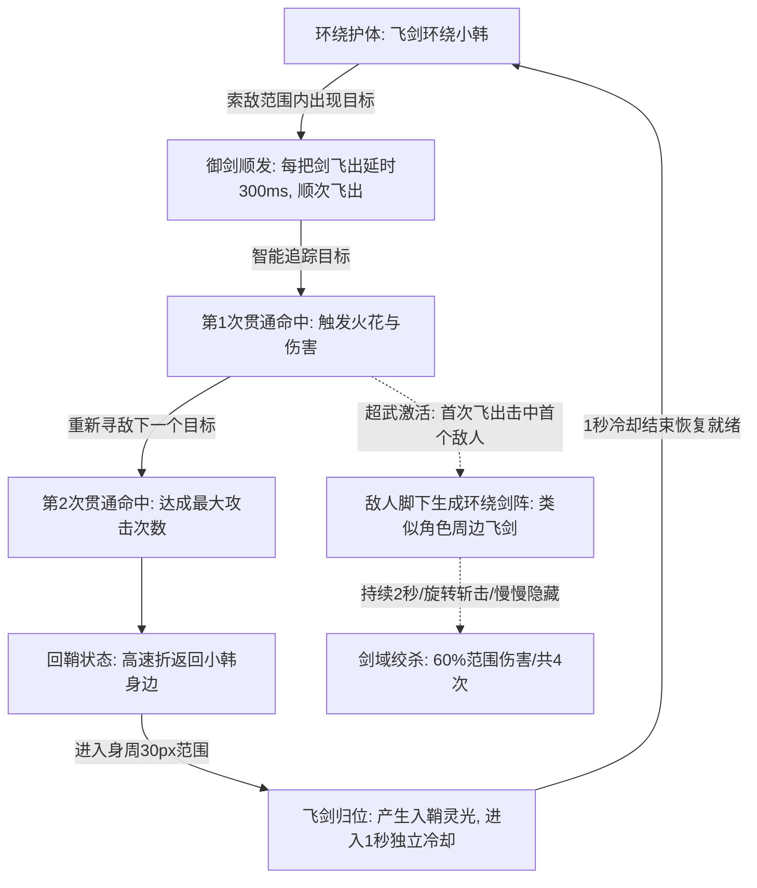

# 青玉剑（Green Jade Sword）武器攻击设计说明

> 关联文档：[总体玩法与核心规则](file:///Users/edy/myProject/aabbBox/设计说明/弹壳打工/总体玩法.md) · [青玉剑](file:///Users/edy/myProject/aabbBox/设计说明/弹壳打工/青玉.md) · [回旋飞刃](file:///Users/edy/myProject/aabbBox/设计说明/弹壳打工/回旋飞刃.md) · [脉冲炮](file:///Users/edy/myProject/aabbBox/设计说明/弹壳打工/脉冲炮.md) · [弧光太刀](file:///Users/edy/myProject/aabbBox/设计说明/弹壳打工/弧光太刀.md) · [AK47](file:///Users/edy/myProject/aabbBox/设计说明/弹壳打工/AK47.md)

---

## 一、武器基本信息与卡片设计

| 属性维度 | 参数数值 / 设定 | 说明 |
| :--- | :--- | :--- |
| **武器名称** | **青玉剑** | 修仙玄幻风格专属御剑类武器 |
| **专属搭配角色** | **小韩**（青袍游侠） | 选择小韩出战时默认绑定装备 |
| **基础伤害** | **10 点** | 初始穿透灵能飞剑，单体与群怪兼备（基准初始值 10） |
| **攻击频率 / 发射间隔** | **0.30 秒/柄**（300ms 依次飞出延时） | 每把飞剑飞出之间增加 300ms 延时，顺次飞出，不能同时全部分出 |
| **攻击有效范围** | **190 px** | 紧凑型中近程战术索敌圈（优化减半后） |
| **飞剑飞行速度** | **500 px/s** | 灵动穿透破空御剑突进（初始基准速度 500） |
| **初始飞剑数量** | **4 柄** | 初始最大环绕飞剑数量（四方对称护体） |
| **单柄飞剑攻击次数** | **2 次** | 每次出击穿透攻击 2 次后自动折返归鞘 |
| **飞剑回鞘再次发射冷却** | **1.0 秒**（独立冷却） | 飞剑归位产生入鞘灵光，进入 1 秒独立冷却后方可再次飞出 |
| **角色持剑动作** | **静态持剑（无挥动硬直）** | 角色左手持剑，剑尖朝向左下方（2.3 rad），纯粹靠意念御剑 |

### 准备页卡片视觉规范
- **布局设计**：卡片顶端展示序号 `5 / 5`，底端为半透明黑底标签居中展示武器名 `青玉剑`；左右切换箭头去除了生硬按钮边框，内嵌悬浮于卡片两侧。
- **武器图标**：
  - **剑格（护手）**：横向高光金属金质渐变，两翼上下对称对齐，消除任何色彩或长度割裂。
  - **剑身**：双刃青玉渐变剑体，剑尖微收带金芒。
  - **剑柄**：中轴居中嵌于剑格后方，整体造型对称挺拔。

---

## 二、战斗机制与循环流程

### 1. 环绕护体阶段（Orbit Phase）
- **阵列分布**：飞剑以角色为中心均匀分布（环绕角度 $\theta = \theta_0 + \frac{2\pi \cdot id}{total}$）。
- **环绕半径**：基础半径为 `34px`，带随时间微幅律动（$\pm 1.5\text{px}$ 呼吸浮动）。
- **朝向规范**：**剑柄朝内指向角色，剑尖朝外对称发散**，剔除杂乱短光翼，呈现纯正仙侠剑阵感。
- **渲染尺寸**：飞剑采用高清子弹光晕素材，长度缩短至原来的 **60%**（长 `19.2px`、宽 `9.4px`），小巧凌厉，不再过于细长。
- **独立回鞘冷却**：飞剑归位时产生入鞘灵光，并进入 **1.0 秒独立冷却**。在 1 秒冷却期内飞剑呈半透明渐隐呼吸闪烁（Alpha 在 `0.3 ~ 1.0` 之间律动），1.0s 冷却结束后立即恢复常亮就绪状态。

### 2. 御剑出击与索敌追踪（Launch & Tracking Phase）
- **触发机制**：当索敌范围内出现敌人时，所有就绪飞剑**每把剑飞出之间增加 300 毫秒（0.3s）的延时顺次飞出，不能同时全部分出**；基准出剑间隔为 0.30 秒/柄（3.33 次/秒，受攻速加成）；无就绪飞剑时动态轮询等待飞剑归位 1.0 秒冷却完成。
- **多目标追踪**：
  - 若范围内存在多个目标：多柄飞剑交替索敌不同目标，实现火力覆盖分流。
  - 若仅有单个目标（如精英/首领）：所有飞剑将锁定同一敌人进行连续集火。
- **追踪转向算法**：出击后飞剑具备角速度纠偏能力（角速度上限为 $15 \text{ rad/s}$），遇机动走位怪物可平滑弧形咬尾追击。

### 3. 多段穿透打击（Multi-Hit Phase）
- **初始贯通攻击次数**：单柄飞剑最多攻击 **2 次**。
- **命中防粘连机制**：每次命中目标后触发 `0.08s` 命中内置冷却，避免同帧多次重复计算同一怪物。
- **转向二段击**：命中首个目标后飞剑立即寻找最近的存活目标继续追踪，完成第 2 次打击。

### 4. 迅疾回鞘归位（Returning Phase）
- **折返触发**：飞剑消耗完 2 次攻击机会（或飞行超时 >2.5s / 飞出边界）时，立刻切为回鞘模式。
- **回冲速度**：以高速折返（基速 $500 \times 1.2 = 600\text{ px/s}$），朝角色当前实时位置直冲。
- **入鞘重置**：接近角色身周 `30px` 判定为成功归鞘，**产生入鞘灵光**（触发翡翠灵能光环扩散、薄荷青火花与清亮归鞘剑鸣），重置攻击次数与状态，开始 **1.0 秒独立冷却**倒计时。

### 5. 超武突破：大庚剑阵（Sword Formation Phase）
- **触发时机**：解锁超武突破【大庚剑阵】后，飞剑**首次飞出击中第一个敌人**时，立即在**敌人脚下**原地生成一座驻留绞杀剑阵。飞剑后续穿透二段击不再重复触发，待折返回鞘后下次重新飞出再次首击敌人方可再次生成。
- **剑阵阵列（类似角色周边的环绕剑阵）**：由 **6 把青玉飞剑** 构成环形飞剑阵列，基准环绕半径为 `38px`。飞剑的朝向与角色身周护体飞剑完全一致：**剑柄朝向中心，剑尖朝外对称发散**，带有微幅呼吸浮动（$\pm 1.5\text{px}$）与灵能辅助阵环。
- **高速旋转**：剑阵内 6 把飞剑原地高速环绕旋转，角速度为 $2.4\text{ rad/s}$，是角色身周基础环绕速度（$1.6\text{ rad/s}$）的 **1.5 倍**。
- **持续时间与渐变消散**：
  - 剑阵在敌人脚下持续存在 **2.0 秒**。
  - 在 2.0 秒存续期内保持完整飞剑尺寸与阵列运转；在存续期后段（最后 0.7 秒）透明度随时间平滑线性衰减，**自然慢慢隐藏消失**，呈现灵动仙侠意境。
- **伤害倍率与判定频率**：
  - **伤害倍率**：剑阵每次判定造成青玉剑基础伤害的 **60%**（`Math.round(s.damage * 0.6)`）。
  - **伤害频率**：**1 秒 2 次**（每 `0.5s` 判定一次范围伤害，2 秒持续期内共判定 4 次范围斩击）。
- **范围打击判定**：判定半径为 $r_{\text{hit}} = 38 + 14 = 52\text{px}$，对敌人脚下圈内所有目标造成高频群体切割。

---

## 三、视觉与音效设计（VFX & Audio）

### 1. 特效表现（VFX）
- **剑身光芒**：剑体四周自带青翠翡翠色光晕辉光（`#5df5b8`，模糊半径 6~9px）。
- **破空拖尾**：
  - 出击飞驰时：剑尾留有淡绿微光光弧（`rgba(93, 245, 184, 0.26)`）与亮白高光流线（`rgba(235, 255, 248, 0.75)`）。
  - 回鞘折返时：剑尾呈现高亮薄荷青归鞘遁光（`rgba(164, 255, 228, 0.45)`）。
- **大庚剑阵特效**：
  - 敌人脚下地面映现翡翠灵能光环与内层旋转虚线阵轨，6 把标准尺寸青玉飞剑如角色身周护体飞剑般围绕敌人脚下环绕飞旋。
  - 持续 2.0 秒，并在最后阶段整体自然慢慢隐藏消失。
- **命中打击效果**：
  - 爆散翡翠色冲击波灵能涟漪（`#5df5b8`）。
  - 迸射青绿星芒火花粒子（`spark` 4~6 枚，剑阵命中产生 5 枚）。
  - 飘出高对比伤害数字（普通暴击区分提示）。
- **战术攻击范围圈**：
  - 去除范围圈上的文字标签（视野无遮挡干扰）。
  - 圈内设微弱青翠辐射光晕与动态流转的虚线刻度环。
  - 外圈设有四个精准十字刻度与前方瞄准弧光。

### 2. 音效设计（Audio）
- **御剑出击音**：采用高低双频结合剑鸣，880Hz 正弦波疾速滑音结合 1420Hz 清越三角波泛音，破空呼啸感十足。
- **命中切割音**：420Hz 三角波破甲击打感与 1080Hz 正弦波清亮剑尖刺中音，打击反馈清脆利落。
- **剑阵共鸣音**：剑阵触发判定时同步激发清脆剑鸣切削回响，强打击感清晰可辨。

---

## 四、升级进化与突破路线

| 强化阶层 | 技能名称 | 强化效果说明（简略展示） | 解锁条件 / 上限 |
| :--- | :--- | :--- | :--- |
| **基础强化** | **万剑诀** | `飞剑 +2（当前 n → n+2柄）`：每次升级额外增加 **2 柄** 环绕飞剑（初始 4 柄 → 6 → 8 → 10 → 12 → 14 → 16 柄）；出击时按 300ms 间隔顺次飞出 | **最多升级至 16 柄**（升级 6 次满级；累计升级 **3 次** 后即开启超武 60% 觉醒几率） |
| **基础强化** | **灵剑回锋** | `攻击次数 +2，伤害 +20%`：每柄飞剑攻击次数 +2 次，飞剑伤害 +20% | **最多出现 3 次**（选满 3 次后不再刷新） |
| **基础强化** | **青竹剑芒** | `伤害 +30%，航速 +20%`：飞剑伤害 +30%，飞行速度 +20%（初始 500 px/s 依此加乘） | 强化上限 4 次 |
| **超武突破（Limit Break）** | **大庚剑阵** | `首击敌人生剑阵`：基础伤害 **+20%**；飞剑**首次飞出击中第一个敌人**时在敌人脚下生成类似角色周边的环绕剑阵（**6 把飞剑** 剑尖朝外高速旋转），持续 **2.0 秒** 后慢慢隐藏；造成 **60% 基础伤害**（**1 秒 2 次，共 4 次**） | **唯一觉醒条件**：**【万剑诀】累计升级 3 次后，每次升级选卡有 60% 概率触发**； **第四卡位赠送**：**作为第 4 个卡片额外出现，且自动选中生效，玩家仍可自由选择另外一张升级卡片**； **抽取限制**：**全局仅生效 1 次**； **视觉规范**：金色 SSR 光芒底色、佩挂【★ 自动激活·赠送】金色勋章与勾选标识 |

### 升级卡片展示规范

1. **升级卡片简略化与纯粹展示**：
   - 卡片仅展示当前升级的具体数据（如 `飞剑 +2（当前 4 → 6柄）`、`伤害 +30%，航速 +20%`、`首击敌人生剑阵`），去除冗余说明文字。
   - **移除“通用”与武器名称文本标签**：卡片右侧已有专属武器/技能素材的图片背景水印，无需重复添加文本标签干扰视觉。
2. **升级卡片排序与第 4 卡位机制**：
   - **基础 3 卡位严格排序**：通用芯片（聚能校准、会心一击等）始终排列最前，武器专属强化（万剑诀、灵剑回锋等）居中后。
   - **第 4 卡位超武自动觉醒**：万剑诀升级 3 次后以 60% 概率激活【大庚剑阵】，作为第 4 张金色独立卡片展示并自动勾选，不消耗常规选卡名额。
3. **下方已选强化芯片标签（重复项折叠为 `*n`）**：
   - 战斗界面底部装备面板的“已选强化芯片”行（`#ext-upgrades-row`），对于重复选取的相同强化，自动折叠展示为 `芯片名 *n`（例如 `聚能校准 *2`、`万剑诀 *3`），使芯片栏始终保持整洁紧凑。

---

> 注：关于游戏全局玩法机制（如虚拟摇杆控制、经验公式与升级成长、通用芯片池、磁铁与血包掉落拾取系统、关卡与首领波次等），请参阅独立文档：[总体玩法与核心规则设计说明](file:///Users/edy/myProject/aabbBox/设计说明/弹壳打工/总体玩法.md)。
